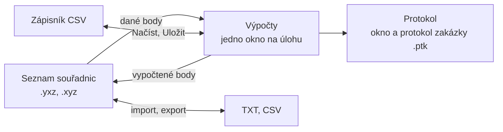

# GeoSoft

GeoSoft je software pro geodetické výpočty. Pracuje nad jedním společným
seznamem souřadnic, ze kterého výpočty berou dané body a do kterého ukládají
body vypočtené.

## Co program umí

- **Seznam souřadnic**: zadávání, mazání, úpravy a hledání bodů, ukládání
  do `.yxz` a `.xyz`, import a export TXT a CSV
- **Měřické metody**: polární metoda (pevné i volné stanovisko),
  ortogonální metoda
- **Přímky**: vyrovnání do přímky, průsečík přímek
- **Protínání**: z délek, ze směrů, zpět
- **Oměrné míry**: konstrukční, konstrukční s vyrovnáním, kontrolní
- **Transformace**: shodnostní, podobnostní, afinní
- **Výpočet výměr** a **technická nivelace**
- **Protokol**: každý výpočet vytvoří protokol, zápis do protokolu zakázky

## Základní konvence

**Číslo bodu** má 15 číslic: katastrální území (6), číslo záznamu
podrobného měření změn ZPMZ (5) a vlastní číslo bodu (4). Stačí zadat
krátké číslo, například `12`, a program doplní předčíslí z lišty v okně.

**Jednotky.** Délky a souřadnice v metrech, úhly v gonech.

**Desetinná místa.** Program počítá v plné přesnosti, počet zobrazených
desetinných míst se mění v okně [Nastavení](nastaveni.md).

**Desetinná čárka.** Na obrazovce se používá oddělovač podle nastavení
Windows, v protokolu a v souborech vždy čárka. Při čtení souborů program
přijme čárku i tečku.

## Jak spolu části souvisí

## Spuštění

Po spuštění je seznam souřadnic prázdný. Založte nový
(*Soubor → Nový seznam*), nebo otevřete existující
(*Soubor → Otevřít seznam*).

Pro předávání dat slouží datová struktura [GeoDataFrame](geodataframe/index.md),
pro software byly vytvořeny upravené varianty komponenty `TStringGrid`
([Komponenty](komponenty/index.md)).
