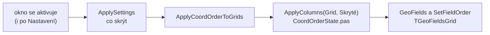

# TGeoFieldsGrid

Tabulka, jejíž sloupce jsou pole `TGeoRow` (CB, Y, X, HZ, SH…). Řádek
tabulky se dá přečíst do `TGeoRow` a zpět, každý sloupec kontroluje
zadávání podle svého pole. Používají ji všechna výpočetní okna.

## Sloupce

| vlastnost | co určuje |
|---|---|
| `ColumnFields` | které sloupce tabulka má a v jakém pořadí, jeden řádek `Pole=Popisek` na sloupec. Nastavuje se v Object Inspectoru. |
| `GeoFields` | množina polí, která jsou právě vidět. Nastavuje ji `ApplyColumns`. |
| `ReadOnlyFields` | pole, která plní program (výsledky). Kurzor je přeskočí, kód do nich píše dál. |

Popisek bez `=` se vezme z `GeoFieldsDef`. Desetinná místa pole
nastaví `SetFieldDecimals`, sloupec pole najde `FieldToCol`,
pole sloupce `ColToField`.

## Skrytí sloupců a pořadí Y a X

`ColumnFields` je úplný seznam, sloupce se neodebírají. Co se nemá
ukázat, okno skryje funkcí `ApplyColumns(Grid, Skryté)`
z `CoordOrderState.pas`. Ta

1. vezme pořadí z `ColumnFields` bez skrytých polí,
2. seřadí dvojice Y a X, Ym a Xm, Vy a Vx podle Nastavení
   (`GCoordOrder`),
3. přepne tabulku (`GeoFields`, `SetFieldOrder`) a vrátí zpět texty
   buněk podle pole, takže zadané hodnoty se při přestavbě neztratí.

Když se nic nezměnilo, tabulku nepřestavuje.



Příklad z polární metody: sloupce, které výpočet zatím nepoužívá,
jsou skryté vždy, výška cíle a popis podle Nastavení.

```pascal
  Hidden := [SS, Zuhel, PolarD, PolarK];
  if not GSettings.Polar.ShowTargetHeight then
    Include(Hidden, VC);
  if not GSettings.Polar.ShowDescription then
    Include(Hidden, Poznamka);
  ApplyColumns(GridOrientation, Hidden);
  ApplyColumns(GridDetail, Hidden);
```

Ostatní okna volají `ApplyColumns(Grid, [])`, nic neskrývají a jen
řadí Y a X.

## Na co dát pozor

- Samotné `SetFieldOrder` nebo změna `GeoFields` přestaví sloupce, ale
  texty buněk zůstanou na svém místě a mohly by se ocitnout pod jiným
  polem. Proto se volá vždy `ApplyColumns`, které texty přenese.
- Nový sloupec se přidá do `ColumnFields` v návrháři, ne v kódu. Při
  ruční úpravě `.dfm` musí sedět `ColCount` a počet `ColWidths`.
- Seznam souřadnic používá jiný grid (`TGeoPointsGrid`) a pořadí Y a X
  řeší sám, viz [Pořadí souřadnic](../seznam-souradnic/poradi-souradnic.md).
