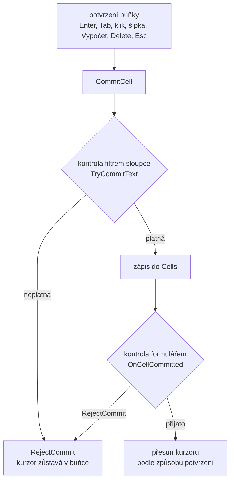

# TGeoGrid

Společný předek obou tabulek. Umí pohyb kurzoru, potvrzení buňky,
filtry sloupců, kreslení, zaškrtávací sloupec a hlavičky. Kód
(`GeoGrid.pas`) je ve stejných skupinách v deklaraci i v tělech
metod: *Moving the cursor*, *Committing a cell*, *Column filters*,
*Drawing*, *Check box column*, *Headers*.

## Editor buňky

Když se v buňce píše, je nad ní malé editační okénko, *inplace editor*.
Tabulka si ho vytvoří v `CreateEditor` jako `TGeoInplaceEdit`.

| metoda | co dělá |
|---|---|
| `KeyDown` | Enter a Tab pošle tabulce, ta rozhodne o pohybu |
| `KeyPress` | spolkne znak Enter a nepovolený znak podle filtru sloupce (`FilterKeyPress`) |
| `TextWithoutSelection` | text, který zbude, když napsaný znak nahradí označenou část. Podle něj filtr hlídá délku. |

`KeyDown` dostává klávesu (Enter, šipky, F2), `KeyPress` až znak,
který z ní vznikne. Obě dostávají `var Key`. Když se do něj dá 0 nebo
`#0`, klávesa se zahodí.

## Události

Tabulka volá kód formuláře přes tři události:

| událost | typ | kdy | co formulář dělá |
|---|---|---|---|
| `OnCellCommitted` | `TCellCommittedEvent` | po potvrzení buňky | přepočítá úlohu |
| `OnCellSelectable` | `TCellSelectableEvent` | když tabulka zjišťuje, jestli smí kurzor do buňky | nastaví `ASelectable := False` |
| `OnCheckChanged` | `TNotifyEvent` | po zaškrtnutí | přepočítá úlohu |

### Co znamená `of object`

```pascal
TCellCommittedEvent = procedure(Sender: TObject; ACol, ARow: Integer) of object;
```

Je to **vzor**, ne procedura, a tělo nemá. Říká, jak musí vypadat
metoda formuláře, kterou jde do události přiřadit. Slova `of object`
znamenají, že odkaz si pamatuje dvě věci: **kterou metodu** zavolat
a **na kterém objektu**. Obsluha je metoda formuláře a pracuje s jeho
daty, takže tabulka musí vědět, který formulář zavolat.

| zápis | co do něj jde přiřadit |
|---|---|
| `procedure(…)` | samostatnou proceduru mimo třídu |
| `procedure(…) of object` | metodu konkrétního objektu, například `LevellingForm.PointCommitted` |
| `reference to procedure(…)` | cokoli, i proceduru napsanou přímo v kódu (v GeoSoftu se nepoužívá) |

Těla jsou ve formulářích. Spojení vznikne v `.dfm`
(`OnCellCommitted = PointCommitted`) dvojklikem na událost
v Object Inspectoru. Tabulka pak volá:

```pascal
  if Assigned(FOnCellCommitted) then
    FOnCellCommitted(Self, Col, Row);
```

`Assigned` zjistí, jestli formulář obsluhu má. `Self` (tabulka) dostane
formulář jako `Sender`.

`OnCellSelectable` má navíc `var ASelectable`. Tabulka se neohlašuje,
ale ptá, a formulář jí odpověď zapíše do proměnné.

## Potvrzení buňky



Hodnotu kontrolují dva stupně:

1. **Filtr sloupce** (`TryCommitText`) ověří datový typ, délku a rozsah
   podle `TColumnFilter`. Výraz vyhodnotí a úhel převede do periody.
   Prázdná buňka předtím dostane výchozí text (`OnGetDefaultText`).
2. **Formulář** v obsluze `OnCellCommitted` posoudí hodnotu
   v souvislostech úlohy a může ji odmítnout voláním `RejectCommit`,
   například když zadaný bod není v seznamu souřadnic.

| způsob potvrzení | editor | kontrola | kurzor potom |
|---|---|---|---|
| Enter, Tab | otevřený | výchozí text, filtr, formulář | následující buňka |
| klik, šipka | otevřený nebo zavřený | při otevřeném editoru stejná | cílová buňka |
| tlačítko Výpočet | otevřený | výchozí text, filtr, formulář | beze změny |
| Delete | zavřený | žádná, buňka se vymaže | beze změny |
| Esc | zavře se | žádná, zadaný text se zahodí | beze změny |

- Při `OnInvalidCommit = ciaBeepAndClear` se neplatná hodnota
  nezablokuje. Buňka se vymaže a formulář dostane `OnCellCommitted`
  stejně jako po Delete.
- `FLastCommitFailed` uchovává odmítnutí z `RejectCommit`. Obsluha
  `OnCellCommitted` je procedura a výsledek vrátit nemůže.
- `FCommitted` brání dvojímu potvrzení. Přesun kurzoru po Enteru
  vyvolá `SelectCell`, který jinak potvrzuje sám kvůli kliku a šipkám.
  `OnCellCommitted` tak přijde právě jednou.

## Filtry sloupců

`TGeoGrid` drží `ColumnFilters`, jeden filtr na datový sloupec.
`CellFilter(ACol)` vrátí filtr sloupce, nebo `nil`. Potomci filtry
jen plní (viz [TGeoPointsGrid](geopointsgrid.md) a
[TGeoFieldsGrid](geofieldsgrid.md)).

Filtr řídí:

- **psaní:** editor zahodí nepovolené znaky,
- **potvrzení:** `TryCommitText` hodnotu zkontroluje a upraví,
- **zámek:** sloupec s `ReadOnly` je pro kurzor zamčený (`CellSelectable`),
- **kreslení:** číslo se zaokrouhlí podle `DecimalPlaces`.

Po změně filtru se tabulka sama překreslí, viz
[Jak filtr oznámí změnu](kontrola-zadavani.md#jak-filtr-oznami-zmenu).

## Zobrazení čísel

`Cells` drží vždy celé číslo. Zaokrouhluje se jen při kreslení:

- `DisplayText(ACol, ARow)` vrátí text buňky tak, jak se ukazuje:
  číslo zaokrouhlené podle `DecimalPlaces` filtru sloupce. `Cells`
  nemění.
- `DrawCell` kreslí `DisplayText`, Delphi při tom nepíše text
  (`DefaultTextDrawing`).
- Formulář, který si buňky kreslí sám (`OnDrawCell`), má sám volat
  `DisplayText`.

Počet míst nastavuje program: `TGeoFieldsGrid.SetFieldDecimals(pole,
místa)` u výpočtů, `ColumnFilters[i].DecimalPlaces` u ostatních tabulek.

## Zaškrtávací sloupec

`CheckColumn` určuje sloupec se zaškrtávátky (−1 = žádný). Stav je
přímo v buňce jako `1` nebo `0` a prázdná buňka znamená
`DefaultChecked`, takže se stav posune s řádkem. Klik nebo mezerník
přepne řádek, klik do hlavičky všechny řádky. Po změně přijde
`OnCheckChanged`.

`TGeoFieldsGrid` sloupec zapne sám, když zobrazuje pole `Checked`.
Dnes ho používá transformace (sloupec Klíč).
