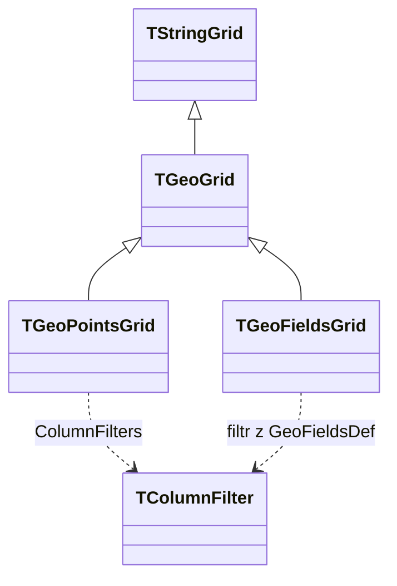

# Komponenty

Balíček `GeoComponentsR` (složka `GeoComponents`) obsahuje tabulky
odvozené z `TStringGrid`. Po změně balíčku je potřeba ho v IDE přeložit
a znovu nainstalovat.

## Přehled

| unit | třída | k čemu |
|---|---|---|
| `GeoGrid.pas` | `TGeoGrid` | společný předek: pohyb Enterem, kreslení, číslování řádků, zaškrtávátka |
| `GeoPointsGrid.pas` | `TGeoPointsGrid` | seznam souřadnic, filtry podle sloupců (`ColumnFilters`) |
| `GeoFieldsGrid.pas` | `TGeoFieldsGrid` | výpočetní okna, sloupce jsou pole `TGeoRow` |
| `GeoColumnValidation.pas` | `TColumnFilter` | kontrola zadávání a výrazy |
| `GeoFieldsDef.pas` | | popisky a filtry všech polí |

## Co mají všechny tabulky společné

- Enter a Tab potvrdí buňku a přejdou na další. Neplatná hodnota
  pohyb zablokuje. Co se stane na konci tabulky, určuje
  `EnterEndBehavior`.
- Po Enteru je hodnota v nové buňce označená a psaní ji přepíše.
  F2 nebo End přepne na doplňování.
- Esc při psaní buňku vyprázdní, druhý Esc vrátí kurzor o buňku zpět.
- Delete vymaže buňku.
- Sloupce jdou roztáhnout myší ve všech tabulkách.
- Řádky jsou v levém sloupci očíslované (`RowNumbers`).
- Po potvrzení buňky přijde událost `OnCellCommitted`, buňku jde
  zašedit a přeskočit přes `OnCellSelectable`.

## Stránky

- [TGeoGrid](geogrid.md)
- [TGeoFieldsGrid](geofieldsgrid.md)
- [Kontrola zadávání](kontrola-zadavani.md)
