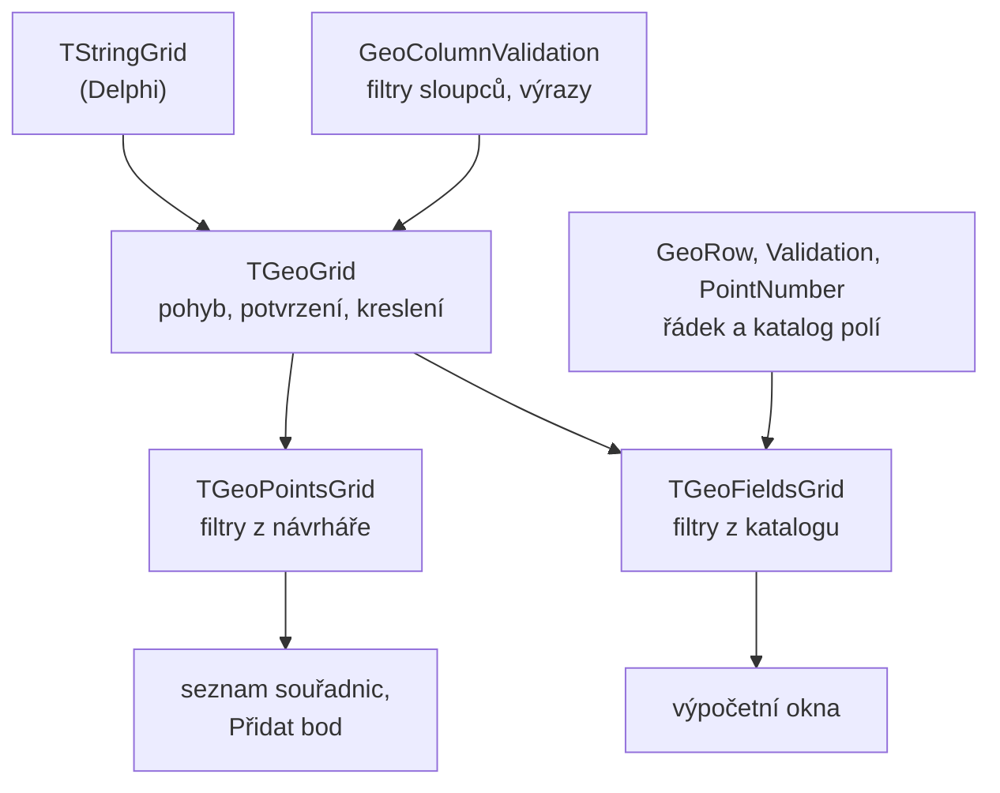

# Komponenty

Balíček `GeoComponentsR` (složka `GeoComponents`) obsahuje tabulky
odvozené z `TStringGrid`. Po změně balíčku je potřeba ho v IDE přeložit
a znovu nainstalovat.

## Přehled

| unit | co v něm je |
|---|---|
| `GeoColumnValidation.pas` | filtr sloupce `TColumnFilter`, seznam filtrů `TColumnFilters`, kontrola zadávání a výrazy |
| `GeoGrid.pas` | `TGeoGrid`, společný předek: pohyb kurzoru, potvrzení buňky, filtry sloupců, kreslení, zaškrtávací sloupec, hlavičky. K tomu editor buňky `TGeoInplaceEdit`. |
| `GeoPointsGrid.pas` | `TGeoPointsGrid`: filtry se nastaví v návrháři. Seznam souřadnic a okno Přidat bod. |
| `GeoFieldsGrid.pas` | `TGeoFieldsGrid`: sloupce jsou pole `TGeoRow`, filtry se vyrobí z katalogu polí. Všechna výpočetní okna. |
| `GeoGridReg.pas` | registrace tabulek na záložku GeoComponents v paletě |
| `GeoRow.pas`, `Validation.pas`, `PointNumber.pas` | datové struktury ze `src/DataStructures`: řádek a katalog polí, meze hodnot, číslo bodu |

Filtry drží předek `TGeoGrid`. Potomci se liší jen tím, **odkud
je berou**: `TGeoPointsGrid` z návrháře (`.dfm`), `TGeoFieldsGrid`
z katalogu polí.

## Co mají všechny tabulky společné

- Enter a Tab potvrdí buňku a přejdou na další. Neplatná hodnota
  pohyb zablokuje. Co se stane na konci tabulky, určuje
  `EnterEndBehavior`.
- Po Enteru je hodnota v nové buňce označená a psaní ji přepíše.
- Esc při psaní buňku vyprázdní, druhý Esc vrátí kurzor o buňku zpět.
- Delete vymaže buňku.
- Šipky vlevo a vpravo přeskočí zamčené buňky.
- Sloupce jdou roztáhnout myší ve všech tabulkách.
- Řádky jsou v levém sloupci očíslované (`RowNumbers`).
- Po potvrzení buňky přijde událost `OnCellCommitted`, právě jednou:
  po Enteru a Tabu, i na poslední buňce, po kliknutí myší do jiné
  buňky a po tlačítku Výpočet, když se v buňce zrovna píše.
  Neplatná hodnota událost nespustí.
- Zamčená buňka je šedá a kurzor ji přeskočí. Zamyká formulář přes
  `OnCellSelectable`, nebo sloupec s `ReadOnly` ve filtru.

## Stránky

- [TGeoGrid](geogrid.md): jak tabulka funguje uvnitř, události
- [TGeoPointsGrid](geopointsgrid.md)
- [TGeoFieldsGrid](geofieldsgrid.md)
- [Kontrola zadávání](kontrola-zadavani.md): filtry a výrazy
