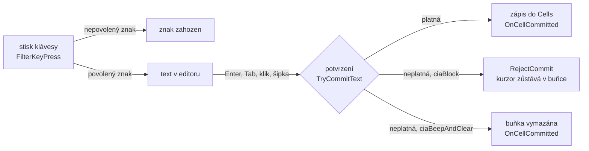
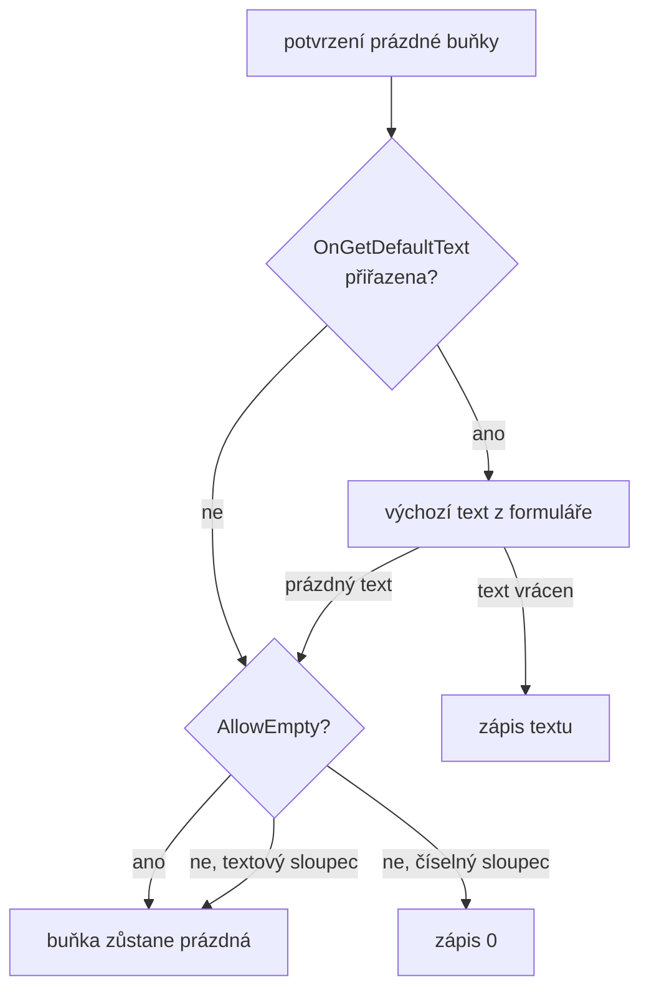
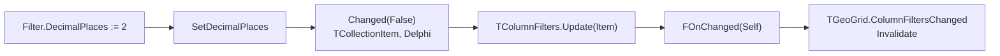

# Kontrola zadávání

Každý sloupec tabulky má filtr (`TColumnFilter`). Filtr hlídá, co jde
do buňky napsat, a při potvrzení hodnotu zkontroluje a upraví.

## Kdy se kontroluje



Průběh potvrzení včetně kontroly formulářem popisuje
[TGeoGrid](geogrid.md#potvrzeni-bunky).

- **Při psaní** filtr zahodí znaky, které typ sloupce nepovoluje,
  a zastaví psaní na nejvyšší délce. Označený text se počítá jako
  přepsaný.
- **Při potvrzení** se zkontroluje délka, typ a rozsah, výraz
  se spočítá a úhel se převede do rozsahu.

## Prázdná buňka



Seznam souřadnic dosadí Y, X a Z = 0, KK a popis z lišty.
Výpočetní okna výchozí text nedávají, prázdná délka nebo úhel
znamená „neměřeno“.

## Vlastnosti filtru

| vlastnost | význam |
|---|---|
| `DataType` | `cdtNone` text, `cdtInteger` celé číslo, `cdtFloat` číslo, `cdtExpression` výraz |
| `MinLength`, `MaxLength` | délka textu, 0 bez omezení |
| `HasMinValue`, `MinValue` | nejmenší hodnota |
| `HasMaxValue`, `MaxValue` | největší hodnota |
| `DecimalPlaces` | zobrazená desetinná místa, buňka drží plnou hodnotu |
| `AllowEmpty` | prázdná buňka smí zůstat prázdná, jinak se z ní v číselném sloupci stane 0 |
| `WrapAt` | perioda, třeba 400 pro gony. Hodnota se posune do rozsahu 0 až WrapAt. |
| `ReadOnly` | sloupec plní program, kurzor ho přeskočí a buňka je šedá |
| `OnInvalidCommit` | `ciaBlock` pípne a kurzor zůstane, `ciaBeepAndClear` pípne, buňku vymaže a formulář dostane `OnCellCommitted` |
| `OnGetDefaultText` | text pro prázdnou buňku, nastavuje se v kódu. Prázdný text znamená výchozí hodnotu sloupce. |
| `Column` | číslo sloupce, jen ke čtení, vidět v Object Inspectoru |

## Znaky při psaní

| typ | povolené znaky |
|---|---|
| celé číslo | číslice, mínus na začátku |
| číslo | číslice, jedna desetinná čárka, mínus na začátku |
| výraz | číslice, desetinná čárka, `+ - * / ^ ( )` a mezera |

Tečka i čárka se přepíšou na oddělovač podle Windows.

## Výrazy

Ve sloupci s výrazem jde napsat třeba `12,5+3` nebo `(100-2)/2`.
Při potvrzení se výraz spočítá a do buňky se zapíše výsledek.

| priorita | operace |
|---|---|
| nejvyšší | závorky |
| | mocnina `^`, zprava doleva (`2^3^2` = 512) |
| | znaménko `+` a `-` (`-2^2` = −4, `2^-1` = 0,5) |
| | `*` a `/` |
| nejnižší | `+` a `-` |

Dělení nulou a výsledek, který není konečné číslo (třeba `0^-1`),
je neplatné zadání.

## Filtry polí

Výpočetní tabulky berou filtr z katalogu polí (`GeoFieldInfo`
v `GeoRow.pas`):

| pole | typ | filtr |
|---|---|---|
| číslo bodu `CB`, `CBm` | celé číslo | až 15 číslic a znaménko |
| souřadnice `Y`, `X`, `Z` | výraz | 2 místa, smí být prázdné |
| délky `SH`, `SS` | výraz | nejméně 0 |
| `HZ` | výraz | 4 místa, perioda 400 |
| `ZU` | výraz | 0 až 400 |
| kód kvality `KK` | celé číslo | 0 až 8 |
| výsledky `M1` až `M4` | číslo | 2 místa, plní program |
| popis `Popis` | text | nejvýš 32 znaků |

Okno může u pole změnit popisek (`ColumnFields`) a počet míst
(`SetFieldDecimals`), celou definici pole `SetFieldInfo`.

## Jak filtr oznámí změnu

Změna `DecimalPlaces` nebo `ReadOnly` mění vzhled tabulky, proto
mají tyhle dvě vlastnosti setter. Ostatní se čtou až při psaní
nebo potvrzení a zapisují se rovnou do pole.

```pascal
procedure TColumnFilter.SetDecimalPlaces(const Value: Integer);
begin
  if FDecimalPlaces = Value then Exit;
  FDecimalPlaces := Value;
  Changed(False);   // this item only, grid redraws
end;
```



- `Changed` zdědil filtr z `TCollectionItem`. **`False` neznamená
  „nezměnilo se“**, ale „změnila se jen tahle položka, ne všechny“
  (parametr se jmenuje `AllItems`). Delphi podle něj pošle seznamu
  `Update(Self)`, u `True` by poslal `Update(nil)`.
- `TColumnFilters.Update` položku nepoužije, vždy zavolá `FOnChanged`.
  V GeoSoftu by tedy `True` fungovalo stejně, `False` je tam proto,
  že je to pravda.
- `FOnChanged` je událost `of object`. Přihlásí se k ní tabulka
  v konstruktoru (`FColumnFilters.OnChanged := ColumnFiltersChanged`)
  a po změně se označí k překreslení.
- `Invalidate` hned nekreslí. Windows tabulku překreslí, až se uvolní,
  takže pět změn za sebou znamená jedno překreslení.
