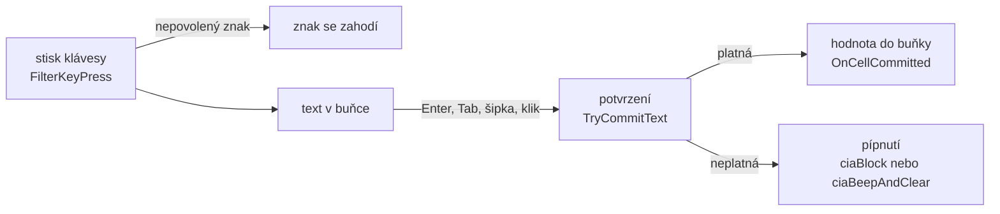

# Kontrola zadávání

Každý sloupec tabulky má filtr (`TColumnFilter`). Filtr hlídá, co jde
do buňky napsat, a při potvrzení hodnotu zkontroluje a upraví.

## Kdy se kontroluje

- **Při psaní** filtr zahodí znaky, které typ sloupce nepovoluje,
  a zastaví psaní na nejvyšší délce. Označený text se počítá jako
  přepsaný.
- **Při potvrzení** se zkontroluje délka, typ a rozsah, výraz
  se spočítá a úhel se převede do rozsahu.

## Vlastnosti filtru

| vlastnost | význam |
|---|---|
| `DataType` | `cdtNone` text, `cdtInteger` celé číslo, `cdtFloat` číslo, `cdtExpression` výraz |
| `MinLength`, `MaxLength` | délka textu, 0 bez omezení |
| `HasMinValue`, `MinValue` | nejmenší hodnota |
| `HasMaxValue`, `MaxValue` | největší hodnota |
| `DecimalPlaces` | zobrazená desetinná místa, buňka drží plnou hodnotu |
| `AllowEmpty` | prázdná buňka smí zůstat prázdná, jinak se z ní v číselném sloupci stane 0 |
| `WrapAt` | perioda, třeba 400 pro gony. Hodnota se posune do rozsahu 0 až WrapAt. |
| `OnInvalidCommit` | `ciaBlock` pípne a kurzor zůstane, `ciaBeepAndClear` pípne a buňku vymaže |
| `OnGetDefaultText` | výchozí text pro prázdnou buňku, nastavuje se v kódu |

## Znaky při psaní

| typ | povolené znaky |
|---|---|
| celé číslo | číslice, mínus na začátku |
| číslo | číslice, jedna desetinná čárka, mínus na začátku |
| výraz | číslice, desetinná čárka, `+ - * / ^ ( )` a mezera |

Tečka i čárka se přepíšou na oddělovač podle Windows.

## Výrazy

Ve sloupci s výrazem jde napsat třeba `12,5+3` nebo `(100-2)/2`.
Při potvrzení se výraz spočítá a do buňky se zapíše výsledek.

| priorita | operace |
|---|---|
| nejvyšší | závorky, znaménko `+` a `-` |
| | mocnina `^`, zprava doleva |
| | `*` a `/` |
| nejnižší | `+` a `-` |

Dělení nulou a výsledek, který není konečné číslo (třeba `0^-1`),
je neplatné zadání.

## Filtry polí

Výpočetní tabulky berou filtr z pole sloupce (`GeoFieldsDef.pas`):

| pole | typ | filtr |
|---|---|---|
| číslo bodu `CB`, `CBm` | celé číslo | až 15 číslic a znaménko |
| souřadnice `Y`, `X`, `Z` | výraz | 2 místa, smí být prázdné |
| délky `SH`, `SS` | výraz | nejméně 0 |
| `HZ` | výraz | 4 místa, perioda 400 |
| `Zuhel` | výraz | 0 až 400 |
| kód kvality `KK` | celé číslo | 0 až 8 |
| poznámka | text | nejvýš 32 znaků |

Okno může filtr pole změnit, třeba ortogonální metoda povolí záporné
staničení.
