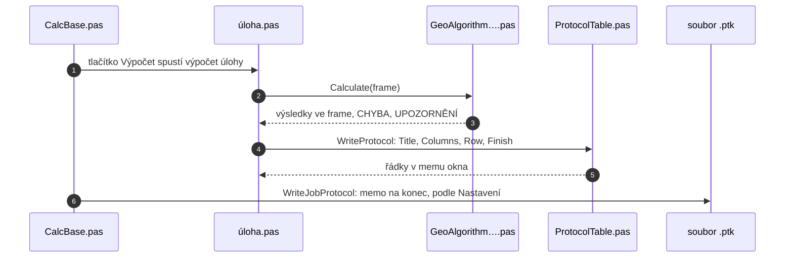

# Protokol

Každé výpočetní okno ukazuje protokol posledního výpočtu: nadpis s názvem
úlohy, upřesnění (např. Volné stanovisko), tabulky a nakonec zprávy:

- **CHYBA:** výpočet nejde, výsledek se neuloží,
- **UPOZORNĚNÍ:** výpočet proběhl, ale něco stojí za pozornost
  (např. překročená mez).

Sloupec **Č.** je řádek v tabulce okna. Body, které výpočet v seznamu
souřadnic přepsal, mají na konci řádku `*** bod v seznamu aktualizován ***`.
Čísla mají desetinnou čárku a počet míst podle Nastavení. Menu
**Uložit protokol** uloží protokol okna do souboru.

## Protokol zakázky

Protokol zakázky je textový soubor vedle seznamu souřadnic, se stejným
jménem a příponou `.ptk` (`Pokus.yxz` → `Pokus.ptk`). Každý zápis začíná
řádkem s datem, časem, KÚ a ZPMZ, pod ním je celý protokol okna. Seznam
souřadnic musí být uložený.

Kdy se zapisuje, určuje Nastavení → Protokol:

| volba | tlačítko Výpočet | tlačítko Zapsat do protokolu |
|---|---|---|
| Protokolovat vše | uloží body a zapíše protokol | skryté |
| Protokolovat ručně | jen uloží body | spočítá znovu a zapíše |
| Neprotokolovat | jen uloží body | skryté |

Do protokolu zakázky se zapíše jen protokol, který výpočet právě napsal,
výsledek se uložil, protokol nemá CHYBU a seznam souřadnic je uložený.
Jinak se nezapíše nic. Menu **Protokol** v hlavním okně i ve výpočetních
oknech otevře protokol zakázky v Poznámkovém bloku.

## Jak to funguje uvnitř

Vzhled protokolu zná jen třída `TProtocol`, obsah zná jen úloha. Proto
vypadají všechny protokoly stejně.



| unit | co v něm je |
|---|---|
| `GUI/CalcBase.pas` | předek oken `TCalcBaseForm`: pole `Prot`, `BeginProtocol`, `FrameTable`, zápis do `.ptk` |
| `GUI/<úloha>.pas` | `WriteProtocol` úlohy, co se do protokolu napíše |
| `GeoAlgorithms/GeoAlgorithm<úloha>.pas` | výpočet, zprávy `AddError` a `AddWarning` |
| `Utils/ProtocolTable.pas` | `TProtocol` (nadpis, tabulky, čáry), sloupce `Col…`, `Num`, `Ang`, `PointId`, `CoordPair` |
| `GUI/PointsManagement.pas` | jméno `.ptk` podle seznamu, otevření v Poznámkovém bloku |

### Jak úloha píše protokol

```pascal
procedure TPolarMethodForm.WriteProtocol(ALines: TStrings);
begin
  if not BeginProtocol(ALines, 'Polární metoda', FAlg.Info.Valid, FFrame,
    FAlg.Warnings) then
    Exit;
  Prot.Text('Pevné stanovisko');
  Prot.Section('STANOVISKO');
  Prot.Columns([ColField(CB), ColPair]);
  Prot.FrameRow(FFrame.Rows[0], []);
  ...
  Prot.Finish(FAlg.Warnings);
end;
```

| metoda | co napíše |
|---|---|
| `BeginProtocol` | nadpis, když výpočet neprošel, hned CHYBU a konec |
| `Prot.Section` | prázdný řádek a nadpis oddílu |
| `Prot.Text`, `Prot.Values` | řádek textu, řádky `popisek = hodnota` |
| `Prot.Columns` | hlavičku tabulky a čáru |
| `Prot.FrameRow` | řádek z řádku frame, volné sloupce dodá okno |
| `Prot.Row` | řádek, všechny buňky dodá okno |
| `FrameTable` | celou tabulku z rozsahu řádků frame |
| `Prot.Finish` | CHYBA, UPOZORNĚNÍ a koncovou čáru |

### Sloupce

| sloupec | co vypíše |
|---|---|
| `ColNumber` | Č., řádek tabulky okna |
| `ColField(CB)` | číslo bodu `000000 00000 0000` |
| `ColField(HZ)`, `ColField(SH, 'Staničení')` | úhel nebo délka z řádku frame, vlastní popisek |
| `ColPair` | Y a X v pořadí podle Nastavení |
| `ColPoint`, `ColLength`, `ColAngle`, `ColText` | volný sloupec, text dodá okno |

Šířku sloupce určí jeho druh a počet desetinných míst v Nastavení, nikdy
není užší než popisek. Text se zarovná doleva, čísla doprava.
