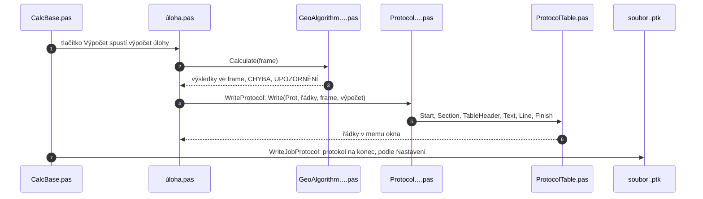

# Protokol

Každé výpočetní okno ukazuje protokol posledního výpočtu: nadpis s názvem
úlohy, upřesnění (např. Volné stanovisko), tabulky a nakonec zprávy:

- **CHYBA:** výpočet nejde, výsledek se neuloží,
- **UPOZORNĚNÍ:** výpočet proběhl, ale něco stojí za pozornost
  (např. překročená mez).

Sloupec **Č.** je řádek v tabulce okna. Body, které výpočet v seznamu
souřadnic přepsal, mají na konci řádku `*** bod v seznamu přepsán ***`,
zprůměrované body `*** bod v seznamu zprůměrován ***`.
Čísla mají desetinnou čárku a počet míst podle Nastavení. Menu
**Uložit protokol** uloží protokol okna do souboru.

## Protokol zakázky

Protokol zakázky je textový soubor vedle seznamu souřadnic, se stejným
jménem a příponou `.ptk` (`Pokus.yxz` → `Pokus.ptk`). Každý zápis začíná
řádkem s datem, časem, KÚ a ZPMZ, pod ním je celý protokol okna. Seznam
souřadnic musí být uložený.

Kdy se zapisuje, určuje Nastavení → Protokol:

| volba | tlačítko Výpočet | tlačítko Zapsat do protokolu |
|---|---|---|
| Protokolovat vše | uloží body a zapíše protokol | skryté |
| Protokolovat ručně | jen uloží body | spočítá znovu a zapíše |
| Neprotokolovat | jen uloží body | skryté |

Do protokolu zakázky se zapíše jen protokol, který výpočet právě napsal,
výsledek se uložil, protokol nemá CHYBU a seznam souřadnic je uložený.
Jinak se nezapíše nic. Menu **Protokol** v hlavním okně i ve výpočetních
oknech otevře protokol zakázky v Poznámkovém bloku.

## Jak to funguje uvnitř

Vzhled protokolu zná jen třída `TProtocol`, obsah zná jen zapisovač
úlohy ve složce `Protocols`. Okno předá jen frame a výpočet. Proto
vypadají všechny protokoly stejně a jdou testovat bez okna.

Č. a poznámku o uložení bodu nese řádek frame: `Line` (řádek gridu)
a `Stored` (bod přepsán nebo zprůměrován). `Line` nastaví předek okna
při plnění frame, u konstrukčních oměrných `GridToFrame` a u orientací
polární metody okno samo. `Stored` nastaví `StorePoint`. Řádek bez `Line`
dostane pořadí 1, 2, 3. Pevné řádky (P/K, A/B, I-1…P) mají v Č. název.



| unit | co v něm je |
|---|---|
| `GUI/CalcBase.pas` | předek oken `TCalcBaseForm`: memo `MemoProtocol`, pole `Prot`, `ShowProtocol`, zápis do `.ptk` |
| `GUI/<úloha>.pas` | `WriteProtocol` úlohy, jen zavolá zapisovač |
| `Protocols/Protocol<úloha>.pas` | zapisovač úlohy, co se do protokolu napíše |
| `GeoAlgorithms/GeoAlgorithm<úloha>.pas` | výpočet, zprávy `AddError` a `AddWarning` |
| `Utils/ProtocolTable.pas` | `TProtocol` (nadpis, oddíly, tabulky, čáry), `LineId`, `StoredText`, `Num`, `Ang`, `PointId`, `CoordPair`, `LimitText` |
| `GUI/PointsManagement.pas` | jméno `.ptk` podle seznamu, otevření v Poznámkovém bloku |

### Jak úloha píše protokol

Okno jen předá, co má:

```pascal
procedure TLineIntersectionForm.WriteProtocol(ALines: TStrings);
begin
  TLineIntersectionProtocol.Write(Prot, ALines, FFrame, FAlg);
end;
```

Zapisovač napíše obsah:

```pascal
if not AProt.Start(ALines, 'Průsečík přímek', AAlg.Valid, AFrame,
  AAlg.Errors, AAlg.Warnings) then
  Exit;
...
AProt.Section('PRŮSEČÍK');
AProt.TableHeader(Format(POINT_LINE,
  ['Č.', 'Číslo bodu', CoordCaption, 'KK', '']));
AProt.Text(Format(POINT_LINE, [POINT_NAMES[LINE_POINTS], PointId(Row.CB),
  CoordPair(Row.X, Row.Y), IntToStr(Row.KK), StoredText(Row)]));
AProt.Line;
AProt.Finish(AAlg.Errors, AAlg.Warnings);
```

| metoda | co napíše |
|---|---|
| `Start` | nadpis, když výpočet neprošel, hned CHYBU a konec, pro prázdný zápisník nic |
| `Section` | prázdný řádek a nadpis oddílu |
| `Text` | řádek textu |
| `TableHeader` | hlavičku tabulky a čáru stejně širokou |
| `Line` | čáru na konec tabulky |
| `Finish` | CHYBA, UPOZORNĚNÍ a koncovou čáru |

### Řádky tabulek

Hlavička i řádky tabulky se píší stejným formátovacím řetězcem
(např. `POINT_LINE`), proto sloupce sedí pod sebou.

| co | co vypíše |
|---|---|
| `LineId(AFrame, I)` | Č., řádek tabulky okna (`Line`), bez něj pořadí 1, 2, 3 |
| `StoredText(Row)` | poznámku za bodem, který výpočet v seznamu přepsal nebo zprůměroval (`Stored`) |
| `PointId` | číslo bodu `000000 00000 0000` |
| `CoordPair`, `CoordCaption` | Y a X v pořadí podle Nastavení a jejich popisek |
| `Num`, `Ang` | délku nebo souřadnici, úhel v gonech, počet míst podle Nastavení |
| `LimitText` | odchylku, mezní rozdíl a vyhovuje nebo nevyhovuje |
