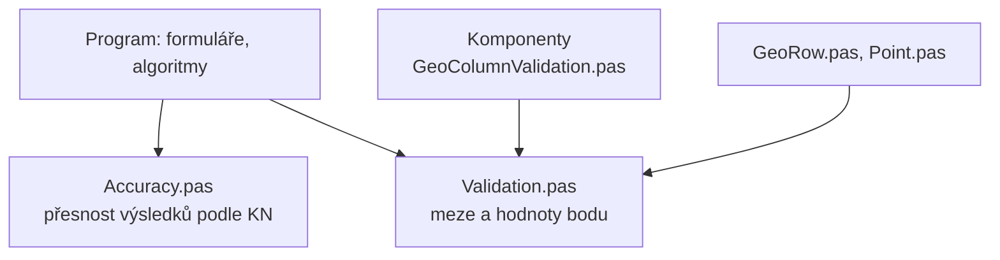

# Validace a přesnost

Kontroly hodnot jsou rozdělené podle vrstev. Každý unit hlídá jednu věc:

| unit | složka | co hlídá |
|---|---|---|
| `GeoColumnValidation.pas` | komponenty | zadávání do tabulky, viz [Kontrola zadávání](../komponenty/kontrola-zadavani.md) |
| `Validation.pas` | datové struktury, i v balíčku komponent | meze a platné hodnoty bodu |
| `Accuracy.pas` | program | přesnost výsledků podle katastrální vyhlášky |

## Validace hodnot

`TValidation` (unit `src/DataStructures/Validation.pas`) kontroluje hodnoty
bodu. Volá ho konstruktor `TPoint.Create`, takže každý bod vytvořený
konstruktorem projde kontrolou.

| funkce | povoleno | jinak |
|---|---|---|
| `ValidatePointNumber` | −999999999999999 až 999999999999999, mimo 0 | 0 |
| `ValidateCoordinate` | konečné číslo | 0 (i prázdná hodnota NaN) |
| `ValidateQuality` | kód kvality 0 až 8 | 0 |
| `ValidateDescription` | popis do 32 znaků | zkrátí se |

Neplatná hodnota se nahradí tiše, bez hlášení. Hodnoty proto hlídají
už tabulky při psaní, validace je poslední pojistka.

Meze jsou zapsané jen jednou, jako konstanty ve `Validation.pas`. Podle nich
se řídí bod, `TGeoRow` i filtry tabulek:

| konstanta | hodnota | význam |
|---|---|---|
| `MAX_POINT_NUMBER` | 999999999999999 | největší číslo bodu, 15 číslic |
| `MAX_CB` | 16 | délka čísla bodu i se znaménkem |
| `MIN_KK`, `MAX_KK` | 0, 8 | rozsah kódu kvality |
| `MAX_POPIS` | 32 | délka popisu |

## Přesnost výsledků

`TAccuracy` (unit `src/Utils/Accuracy.pas`) počítá meze přesnosti podle
katastrální vyhlášky. Používají ho výpočty a protokoly.

- `MxyOfQuality` – $M_{xy}$ kódu kvality podle KatV 13.9 a 15.6, pro
  ostatní kódy neurčeno:

    | kód kvality | 3 | 4 | 5 | 6 | 7 | 8 |
    |---|---|---|---|---|---|---|
    | $M_{xy}$ [m] | 0,14 | 0,26 | 0,50 | 0,21 | 0,50 | 1,00 |

- `MxyBand` – pásmo bodu podle $S_{xy}$: do Mxy ($S_{xy} < M_{xy}$),
  do Uxy ($S_{xy} \le U_{xy}$, $U_{xy} = 2\,M_{xy}$), přes Uxy, podle
  KatV 13.7 a 13.8
- `LengthLimit` – mezní rozdíl délky
  $u_d = 2\sqrt{2}\, m_{xy} \frac{d + 12}{d + 20}$, bez $M_{xy}$ neurčen
- `LowerQuality` – horší kód kvality ze dvou bodů. Kód 0 dává 0, kód bez
  $M_{xy}$ ustoupí druhému, jinak rozhoduje větší $M_{xy}$.
