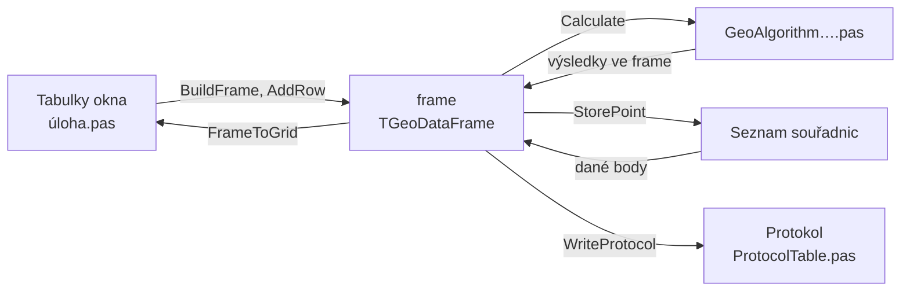

# Geodetické výpočty

Každá úloha má vlastní okno. Okno je zápisník jedné úlohy, jeden řádek
tabulky je jedno měření.

## Úlohy

| kód | úloha |
|---|---|
| 0 | [Ortogonální metoda](ortogonalni-metoda.md) |
| 1 | [Polární metoda](polarni-metoda.md) |
| 2 | [Vyrovnání do přímky](vyrovnani-do-primky.md) |
| 3 | [Průsečík přímek](prusecik-primek.md) |
| 4 | [Konstrukční oměrné](konstrukcni-omerne.md) |
| 5 | [Protínání z délek](protinani-z-delek.md) |
| 6 | [Protínání ze směrů](protinani-ze-smeru.md) |
| 7 | [Konstrukční oměrné s vyrovnáním](konstrukcni-omerne-s-vyrovnanim.md) |
| 8 | [Protínání zpět](protinani-zpet.md) |
| 9 | [Kontrolní oměrné](kontrolni-omerne.md) |
| 51 | [Technická nivelace](technicka-nivelace.md) |
| 65 | [Transformace](transformace.md) |
| 95 | [Výpočet výměr](vymera.md) |

## Společné chování

- Všechna okna dědí z předka `TCalcBaseForm` (`GUI/CalcBase.pas`).
  Ten dává lištu s předčíslím, tlačítka Načíst, Uložit a Výpočet,
  protokol ve spodní části okna a menu Úloha, Nastavení, Protokol
  a Nápověda.
- Dané body se berou ze seznamu souřadnic, rozhoduje seznam, ne buňka.
- Vypočtené body se ukládají do seznamu. Bod, který už v seznamu je,
  se přepíše s dotazem: ponechat, nový, průměr, nové číslo.
- Č. v protokolu odpovídá řádku v tabulce, i když se prázdné řádky
  přeskočí.
- Zápisník se ukládá a načítá jako CSV vedle programu. Vadné řádky
  se při načtení přeskočí a vypíšou.
- Nápověda otevře stránku úlohy v této dokumentaci.

## Průběh výpočtu

Výpočet dostane vždy jen frame a výsledky zapíše zpět do něj. Okno
si u každého řádku frame pamatuje řádek tabulky (`FRows`), podle toho
vrací výsledky do tabulky a čísluje protokol.
