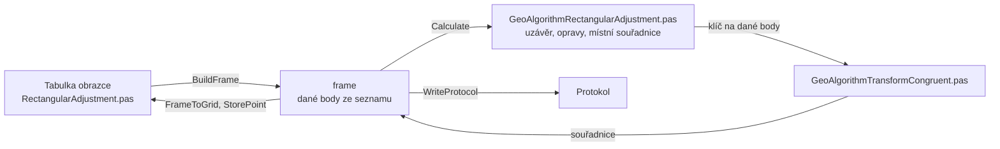

# Konstrukční oměrné s vyrovnáním

Úloha 7 vyrovná uzavřený pravoúhlý obrazec z oměrných měr. Uzávěr
se rozdělí úměrně délkám stran a obrazec se shodnostní transformací
umístí na všechny dané body.

## Co umí

- Jedna tabulka je obrazec po obvodu: číslo bodu a délka strany
  od předchozího bodu. Kladná délka znamená zatáčku vpravo, záporná
  vlevo.
- Obrazec musí být uzavřený: poslední řádek je zase první bod.
  Má aspoň čtyři strany.
- Bod ze seznamu souřadnic se po dotazu vezme jako daný, nebo
  se počítá jako nový. Potřeba jsou aspoň dva dané body.
- Místní souřadnice X a Y místní se překreslí po každé změně.
- Výpočet uloží vypočtené body do seznamu, bod, který už v seznamu je,
  se přepíše s dotazem. Dané body si ponechají své souřadnice.
- Nový bod dostane kód kvality a popis z panelu.
- Délky se násobí měřítkem délek z Nastavení.
- Jeden zápisník je jeden obrazec.

## Kde se co počítá

| unit | výpočet |
|---|---|
| `GUI/RectangularAdjustment.pas` | tabulka → frame, místní souřadnice, výsledky zpět, uložení bodů, zápisník, protokol |
| `GeoAlgorithms/GeoAlgorithmRectangularAdjustment.pas` | obrazec, uzávěr, oprava stran, transformace |
| `GeoAlgorithms/GeoAlgorithmTransformCongruent.pas` | shodnostní transformace, viz [Transformace](transformace.md) |

## Matematika

### Značení

| značka | v kódu | význam |
|---|---|---|
| $a_i$ | `SH` | délka strany se znaménkem, + vpravo, − vlevo |
| $t_i$ | `TS` | znaménko $a_i$ |
| $m$ | `Scale` | měřítko délek |
| $u_x, u_y$ | `DirX`, `DirY` | jednotkový směr chůze, na začátku $(1, 0)$ |
| $f_x, f_y$ | `FirstDirX`, `FirstDirY` | směr první strany |
| $\Delta x_i, \Delta y_i$ | `StepX`, `StepY` | krok po straně |
| $D_x, D_y$ | `ClosureX`, `ClosureY` | uzávěr v osách |
| $D_p, D_q$ | `ClosureAlong`, `ClosureAcross` | uzávěr podélný a příčný |
| $a'_i$ | `Adjusted` | vyrovnaná strana |
| $x_i, y_i$ | `Xm`, `Ym` | místní souřadnice |
| $m_0$ | `MeanError` | střední chyba transformace |

### Obrazec a uzávěr

Před každou stranou se směr otočí o pravý úhel:

$$
u_x' = -t_i\, u_y, \qquad u_y' = t_i\, u_x
$$

$$
\Delta x_i = |a_i|\, m\, u_x', \qquad \Delta y_i = |a_i|\, m\, u_y'
$$

$$
D_x = \sum_i \Delta x_i, \qquad D_y = \sum_i \Delta y_i
$$

Uzávěr vzhledem k první straně, příčný je kladný vpravo:

$$
D_p = D_x f_x + D_y f_y, \qquad D_q = -D_x f_y + D_y f_x
$$

### Vyrovnání

Uzávěr se v každé ose rozdělí úměrně délkám kroků:

$$
\Delta x_i' = \Delta x_i - D_x \frac{|\Delta x_i|}{\sum |\Delta x|}, \qquad
\Delta y_i' = \Delta y_i - D_y \frac{|\Delta y_i|}{\sum |\Delta y|}
$$

$$
x_i = \sum_{k \le i} \Delta x_k', \qquad y_i = \sum_{k \le i} \Delta y_k'
$$

$$
a_i' = t_i \left( |\Delta x_i'| + |\Delta y_i'| \right), \qquad
\text{oprava} = a_i' - a_i\, m
$$

Místní souřadnice se shodnostní transformací přenesou na všechny dané
body, každý daný bod jednou. Střední chyba transformace pro $n$ daných
bodů:

$$
m_0 = \sqrt{\frac{[vv]}{2n - 3}}
$$

## Přesnost

- Protokol vypíše uzávěr podélný a příčný, opravy stran, odchylky
  $v_y, v_x$ na daných bodech a střední chybu. Mez uzávěru se
  nekontroluje.
- Střední chyba se vypíše jen při nadbytečnosti, tedy od dvou daných
  bodů výš ($2n - 3 > 0$).
- Chyba: méně než čtyři strany, obrazec není uzavřený, strana bez
  délky, všechny strany v jedné přímce, méně než dva dané body.
