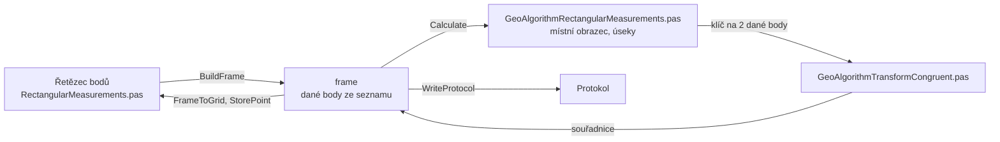

# Konstrukční oměrné

Úloha 4 určí body obvodu budovy z oměrných měr. Z délek a směrů
zatáček se postaví místní obrazec a ten se shodnostní transformací
umístí na dané body.

## Co umí

- Jedna tabulka je řetězec bodů po obvodu: číslo bodu a délka
  od předchozího bodu. Kladná délka znamená zatáčku vpravo, záporná
  vlevo, nula žádný krok.
- První bod řetězce musí být v seznamu souřadnic. Další bod ze seznamu
  se po dotazu vezme jako daný, nebo se počítá jako nový.
- Řetězec se dělí na úseky mezi dvěma danými body s různým číslem.
  Každý úsek se počítá zvlášť. Návrat na stejný bod úsek neuzavře.
- Místní souřadnice X a Y místní se překreslí po každé změně.
- Výpočet uloží vypočtené body úseků do seznamu, bod, který už
  v seznamu je, se přepíše s dotazem. Body za posledním daným bodem
  se nespočítají a vypíše se jejich počet.
- Nový bod dostane kód kvality a popis z panelu.
- Délky se do mapy násobí měřítkem délek z Nastavení.
- Jeden zápisník je jeden řetězec.

## Kde se co počítá

| unit | výpočet |
|---|---|
| `GUI/RectangularMeasurements.pas` | tabulka → frame, místní souřadnice, výsledky zpět, uložení bodů, zápisník, protokol |
| `GeoAlgorithms/GeoAlgorithmRectangularMeasurements.pas` | místní obrazec, úseky, transformace, mez délky |
| `GeoAlgorithms/GeoAlgorithmTransformCongruent.pas` | shodnostní transformace, viz [Transformace](transformace.md) |
| `Utils/ValidationUtils.pas` | mezní rozdíl délky a horší kód kvality |

## Matematika

### Značení

| značka | v kódu | význam |
|---|---|---|
| $d$ | `D` | délka se znaménkem, + vpravo, − vlevo |
| $t$ | `TS` | znaménko $d$ |
| $u_x, u_y$ | `DirX`, `DirY` | jednotkový směr chůze, na začátku $(1, 0)$ |
| $x, y$ | `CurX`, `CurY` | místní souřadnice, začátek $(0, 0)$ |
| $m$ | `Scale` | měřítko délek |
| $s_m$ | `MeasDist` | délka úseku z místních souřadnic |
| $s_v$ | `CalcDist` | délka úseku z daných bodů |

### Místní obrazec

Před každým krokem se směr otočí o pravý úhel podle znaménka,
pak se ujde $|d|$:

$$
u_x' = -t\, u_y, \qquad u_y' = t\, u_x
$$

$$
x = x + |d|\, u_x', \qquad y = y + |d|\, u_y'
$$

Do výpočtu úseku jde $d \cdot m$. Místní souřadnice v tabulce jsou bez
měřítka.

### Úsek

Místní souřadnice úseku se shodnostní transformací přenesou na dva
dané koncové body. Dané body si ponechají své souřadnice. $Z$ je
začátek, $K$ konec úseku:

$$
s_m = \sqrt{(x_K - x_Z)^2 + (y_K - y_Z)^2}, \qquad s_v = \sqrt{(X_K - X_Z)^2 + (Y_K - Y_Z)^2}
$$

## Přesnost

- Odchylka $|s_v - s_m|$ se porovná s mezním rozdílem
  $u_d = 2\sqrt{2}\, m_{xy} \frac{d + 12}{d + 20}$ pro $d = \max(s_m, s_v)$
  (KatV, příloha 13.5 a 13.6). Rozhoduje horší kód kvality koncových
  bodů. Odchylka, která není menší než $u_d$, vypíše upozornění.
  Pro kódy bez Mxy se mez nekontroluje.
- Úsek s více než 8 mezilehlými body vypíše upozornění.
- Chyba: první bod řetězce není daný, bod úseku nemá délku, daný bod
  nemá souřadnice, úsek s méně než 3 body.
