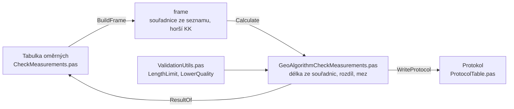

# Kontrolní oměrné

Úloha 9 porovná oměrné míry změřené v terénu s délkami spočtenými
ze souřadnic (KatV § 81 bod 8).

## Co umí

- Jeden řádek je jedna oměrná: Z bodu, Na bod a měřená délka.
  Sloupce Ze souřadnic, Rozdíl, Mezní a Vyhovuje počítá program.
- Body se berou ze seznamu souřadnic. Oměrná s bodem, který
  v seznamu není, se nepočítá a dostane „chybí bod“.
- Měřená délka smí chybět. Oměrná pak dostane „neměřeno“ a v protokolu
  se uvede délka ze souřadnic v závorkách (KatV příloha 17.11).
- Po každé změně se všechny oměrné přepočítají.
- Měřená délka se násobí měřítkem délek z Nastavení.
- Nic se neukládá do seznamu souřadnic, úloha jen kontroluje.
- Výsledek řádku je vyhovuje, nevyhovuje, neměřeno, bez Mxy nebo
  chybí bod.

## Kde se co počítá

| unit | výpočet |
|---|---|
| `GUI/CheckMeasurements.pas` | tabulka → frame, body ze seznamu, horší kód kvality, výsledky do tabulky, zápisník, protokol |
| `GeoAlgorithms/GeoAlgorithmCheckMeasurements.pas` | délka ze souřadnic, rozdíl, mez, souhrn |
| `Utils/ValidationUtils.pas` | mezní rozdíl délky a horší kód kvality |

## Matematika

### Značení

| značka | v kódu | význam |
|---|---|---|
| $Y, X$ | `Y`, `X` | souřadnice bodu Z bodu |
| $Y_m, X_m$ | `Ym`, `Xm` | souřadnice bodu Na bod |
| $s$ | `SH` | měřená délka |
| $m$ | `Scale` | měřítko délek |
| $s_v$ | `SS` | délka ze souřadnic |
| $\Delta$ | `Diff` | rozdíl |
| $u_d$ | `Tolerance` | mezní rozdíl |
| $m_{xy}$ | `MxyOfQuality` | střední souřadnicová chyba horšího kódu kvality |

### Výpočet

$$
s_v = \sqrt{(X_m - X)^2 + (Y_m - Y)^2}
$$

$$
\Delta = s \cdot m - s_v
$$

$$
u_d = 2\sqrt{2}\, m_{xy} \frac{d + 12}{d + 20}, \qquad d = \max(s \cdot m,\ s_v)
$$

Oměrná vyhovuje, když $|\Delta| < u_d$.

## Přesnost

- Mez je podle KatV, příloha 13.5 a 13.6. Rozhoduje horší kód
  kvality z obou bodů. Pro kódy bez Mxy se mez nekontroluje
  a oměrná dostane „bez Mxy“.
- Oměrná, která nevyhovuje, vypíše upozornění.
- Chyba: body oměrné jsou blíž než 1 mm.
- Protokol na konci shrne počet měřených oměrných, nevyhovujících,
  neměřených, nespočítaných a bez Mxy a největší rozdíl.
