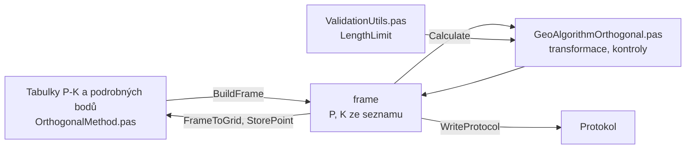

# Ortogonální metoda

Úloha 0 určí podrobné body ze staničení a kolmice na měřické přímce
P-K. Souřadnice se počítají podobnostní transformací z pásma
do S-JTSK.

## Co umí

- Horní tabulka je měřická přímka: body P a K ze seznamu souřadnic,
  jejich staničení a kolmice na pásmu.
- Dolní tabulka jsou podrobné body: číslo, staničení a kolmice.
  Kolmice vpravo od směru P→K je kladná. Záporné staničení je bod
  před bodem P.
- Prázdné staničení nebo kolmice se po Enteru doplní nulou.
- Tlačítko Výpočet nejdřív ověří, že P a K jsou v seznamu.
- Po každé změně v dolní tabulce se body přepočítají a uloží
  do seznamu. Bod, který už v seznamu je, se přepíše s dotazem
  (ponechat, nový, průměr, nové číslo).
- Nový bod dostane kód kvality a popis z panelu, pokud nejsou
  vyplněné.
- Staničení i kolmice se násobí měřítkem délek z Nastavení.
- Jeden zápisník je jedna měřická přímka.

## Kde se co počítá

| unit | výpočet |
|---|---|
| `GUI/OrthogonalMethod.pas` | tabulky → frame, výsledky zpět, uložení bodů, zápisník, protokol |
| `GeoAlgorithms/GeoAlgorithmOrthogonal.pas` | transformace, délka přímky, kontroly prodloužení a kolmice |
| `Utils/ValidationUtils.pas` | mezní rozdíl délky a horší kód kvality |

## Matematika

### Značení

| značka | v kódu | význam |
|---|---|---|
| $Y, X$ | `Y`, `X` | souřadnice S-JTSK |
| $m$ | `Scale` | měřítko délek |
| $s_P, q_P$ | `sP`, `qP` | staničení a kolmice bodu P krát měřítko |
| $\Delta S, \Delta Q$ | `dS`, `dQ` | rozdíl staničení a kolmice K − P krát měřítko |
| $\Delta X, \Delta Y$ | `dx`, `dy` | rozdíl souřadnic K − P |
| $j$ | `j` | $\Delta S^2 + \Delta Q^2$ |
| $L$ | `L` | délka přímky z pásma |
| $L_g$ | `Lg` | délka přímky ze souřadnic |
| $A, B$ | `A`, `B` | koeficienty transformace |
| $s_i, q_i$ | `si`, `qi` | staničení a kolmice podrobného bodu krát měřítko |

### Výpočet

$$
s_P = SH_P \cdot m, \qquad q_P = PolarK_P \cdot m
$$

$$
\Delta S = (SH_K - SH_P)\, m, \qquad \Delta Q = (PolarK_K - PolarK_P)\, m
$$

$$
j = \Delta S^2 + \Delta Q^2, \qquad L = \sqrt{j}, \qquad L_g = \sqrt{\Delta X^2 + \Delta Y^2}
$$

$$
A = \frac{\Delta X\, \Delta S + \Delta Y\, \Delta Q}{j}, \qquad B = \frac{\Delta Y\, \Delta S - \Delta X\, \Delta Q}{j}
$$

$$
X = X_P + A\,(s_i - s_P) - B\,(q_i - q_P), \qquad Y = Y_P + B\,(s_i - s_P) + A\,(q_i - q_P)
$$

## Přesnost

- Odchylka délky přímky $|L_g - L|$ se porovná s mezním rozdílem
  $u_d = 2\sqrt{2}\, m_{xy} \frac{d + 12}{d + 20}$ pro $d = \max(L, L_g)$
  (KatV, příloha 13.5 a 13.6). Rozhoduje horší kód kvality z P a K.
  Odchylka, která není menší než $u_d$, vypíše upozornění. Pro kódy
  bez Mxy se mez nekontroluje.
- Prodloužení za bod P nebo K je nejvýš $L/3$ (vyhl. 31/1995, bod
  10.2 i)), delší vypíše upozornění.
- Kolmice je nejvýš $\min(30\ \mathrm{m},\ 0{,}75\,L)$ (vyhl. 31/1995,
  bod 10.2 j)). Delší vypíše upozornění.
- Chyba: P a K blíž než 1 cm nebo bez souřadnic, chybí staničení
  nebo kolmice P a K, P a K na pásmu splývají.
