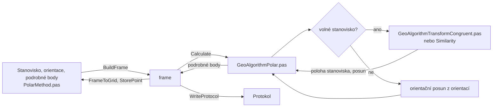

# Polární metoda

Úloha 1 určí body ze stanoviska měřeným směrem a délkou. Stanovisko
je pevné (bod ze seznamu), nebo volné (určí se z orientací).

## Co umí

- Stanovisko: číslo, výška stroje. Pevné stanovisko bere souřadnice
  a výšku ze seznamu, volné je určí výpočet.
- Horní tabulka jsou orientace na body ze seznamu, dolní podrobné body.
- Nastavení, záložka Úlohy:
    - Délky vodorovné, nebo šikmé se zenitovým úhlem,
    - Počítat výšky (výška stroje, výška cíle, zenitový úhel),
    - Polární doměrek a Polární kolmice,
    - popis bodu, shodnostní transformace u volného stanoviska.
- Nezadaná výška cíle podrobného bodu je naposledy zadaná, u prvního
  bodu výška stroje. Výška cíle 0 je platná (bezhranolové měření).
- Bod s výškou 0 výšku nemá.
- Výpočet uloží podrobné body a volné stanovisko do seznamu.
- Zápisník si pamatuje typ délky (0 vodorovná, 2 šikmá). Při načtení
  podle něj přepne nastavení a sloupce.
- Jeden zápisník je jedno stanovisko.

## Kde se co počítá

| unit | výpočet |
|---|---|
| `GUI/PolarMethod.pas` | tabulky → frame, výsledky zpět, protokol, uložení bodů, zápisník |
| `GeoAlgorithms/GeoAlgorithmPolar.pas` | orientační posun, volné stanovisko, podrobné body, výšky |

## Matematika

### Značení

| značka | v kódu | význam |
|---|---|---|
| $\psi$ | `psi` | měřený vodorovný směr |
| $\sigma$ | `sigma` | směrník |
| $\varphi$ | `phi` | orientační posun |
| $p$ | `p` | váha orientace |
| $v, w$ | `dPhi`, `Normed` | odchylka orientačního posunu, normovaná odchylka |
| $m_0$ | `m0` | jednotková střední chyba směru |
| $s, z$ | `SS`, `Zuhel` | šikmá délka, zenitový úhel |
| $d$ | `SH` | vodorovná délka |
| $D, k$ | `PolarD`, `PolarK` | doměrek, kolmice (vpravo kladná) |
| $vs, vc$ | `VS`, `VC` | výška stroje, výška cíle |
| $\Delta h$ | `HeightDiff` | převýšení záměry |

Délky $d$, $D$, $k$ se násobí měřítkem délek z Nastavení, převýšení ne.

### Délka a převýšení

$$
d = s \sin z
$$

$$
\Delta h = s \cos z \ \ \text{(šikmá délka)}, \qquad \Delta h = d \cot z \ \ \text{(vodorovná délka)}
$$

Převýšení se neopravuje o zakřivení Země a refrakci.

### Pevné stanovisko

Váha je délka ze souřadnic dělená nejdelší orientací:

$$
p_i = \frac{s_i}{s_{max}}
$$

$$
\varphi = \operatorname{atan2}\left( \sum p_i \sin(\sigma_i - \psi_i),\ \sum p_i \cos(\sigma_i - \psi_i) \right)
$$

$$
v_i = \varphi - (\sigma_i - \psi_i), \qquad m_0 = \sqrt{\frac{\sum p_i v_i^2}{n - 1}}, \qquad w_i = v_i \sqrt{p_i}
$$

Rozdíl délek orientace, vypočtená minus měřená:

$$
ds_i = s_i - d_i
$$

### Volné stanovisko

Orientace se převedou do místní soustavy kolem přístroje,
$y = d \sin\psi$, $x = d \cos\psi$, a shodnostní, nebo Helmertova
transformace je položí na dané body. Posun je poloha stanoviska,
otočení orientační posun.

Výška stanoviska je průměr z orientací na body s výškou:

$$
Z_S = \frac{1}{n} \sum \left( Z_i + vc_i - vs - \Delta h_i \right)
$$

### Podrobný bod

$$
\sigma = \varphi + \psi
$$

$$
Y = Y_S + (d + D) \sin\sigma + k \cos\sigma, \qquad X = X_S + (d + D) \cos\sigma - k \sin\sigma
$$

$$
Z = Z_S + vs + \Delta h - vc
$$

## Přesnost

- Normovaná odchylka $|w|$ nebo $m_0$ nad $0{,}08$ gon je upozornění
  (Návod pro obnovu KO, bod 4.3.5.1.2 c)).
- Rozdíl délek orientace $ds$ musí být menší než $u_d$ podle KatV,
  body přílohy 13.5 a 13.6, pro horší kód kvality stanoviska
  a orientace. Bod bez kódu kvality vezme kód druhého bodu.
- Bod dál než nejvzdálenější orientace je upozornění (Návod,
  bod 4.3.2.2.2).
- Volné stanovisko: odchylky transformace se zařadí do pásem do Mxy,
  do Uxy a přes Uxy (KatV, body přílohy 13.7 až 13.9).
- Odchylky výšek orientací $dZ$ jsou jen pro informaci.
