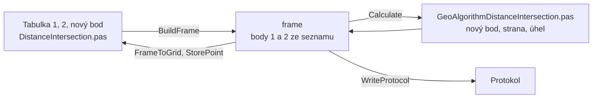

# Protínání z délek

Úloha 5 určí nový bod z délek měřených z bodů 1 a 2.

## Co umí

- Jedna tabulka o třech řádcích:
    - řádek 1 a 2: výchozí bod a měřená délka z něj na nový bod,
      souřadnice a kód kvality se doplní ze seznamu,
    - řádek 3: číslo nového bodu a kontrolní délka 1-2.
- Znaménko kontrolní délky určuje stranu: kladná znamená nový bod
  vpravo od směru 1→2, záporná vlevo. Délka 0 nebo prázdná znamená
  vpravo, −1 vlevo, v obou případech bez kontroly.
- Pod tabulkou se ukáže strana a jak sedí kontrolní délka.
- Výpočet uloží nový bod do seznamu, bod, který už v seznamu je, se
  přepíše s dotazem.
- Jeden zápisník je jeden bod.

## Kde se co počítá

| unit | výpočet |
|---|---|
| `GUI/DistanceIntersection.pas` | tabulka → frame, výsledek zpět, protokol, uložení bodu, zápisník |
| `GeoAlgorithms/GeoAlgorithmDistanceIntersection.pas` | nový bod, strana, kontrolní délka, úhel protnutí, kód kvality |

## Matematika

### Značení

| značka | v kódu | význam |
|---|---|---|
| $Y, X$ | `Y`, `X` | souřadnice S-JTSK |
| $\Delta X_{12}, \Delta Y_{12}$ | `DeltaX12`, `DeltaY12` | rozdíly z bodu 1 do 2 |
| $s_{12}$ | `s12` | délka 1-2 ze souřadnic |
| $s_1, s_2$ | `s1`, `s2` | měřené délky krát měřítko |
| $p$ | `p` | pata výšky trojúhelníku na spojnici 1-2, od bodu 1 |
| $h$ | `h` | výška trojúhelníku |
| $\varepsilon$ | `epsilon` | +1 vpravo od 1→2, −1 vlevo |
| $\omega$ | `omega` | úhel protnutí v novém bodě |

### Výpočet

$$
s_{12} = \sqrt{\Delta X_{12}^2 + \Delta Y_{12}^2}
$$

$$
p = \frac{s_1^2 - s_2^2 + s_{12}^2}{2\, s_{12}}, \qquad h = \sqrt{s_1^2 - p^2}
$$

$$
X_P = X_1 + \frac{p\, \Delta X_{12} - \varepsilon\, h\, \Delta Y_{12}}{s_{12}}, \qquad
Y_P = Y_1 + \frac{p\, \Delta Y_{12} + \varepsilon\, h\, \Delta X_{12}}{s_{12}}
$$

Záporné číslo pod odmocninou znamená, že se délky neprotnou.

Úhel protnutí $\omega$ je úhel mezi spojnicemi nového bodu s body 1 a 2
(0 až 200 gon).

## Přesnost

- Kód kvality nového bodu je horší z bodů 1 a 2.
- Měřená kontrolní délka krát měřítko se porovná s délkou $s_{12}$ ze
  souřadnic. Rozdíl musí být menší než $u_d$ podle KatV, body přílohy
  13.5 a 13.6, z horšího kódu kvality bodů 1 a 2. Jinak se vypíše
  upozornění.
- Neměřená kontrolní délka vypíše upozornění, že délka 1-2 je jen ze
  souřadnic.
- Úhel protnutí mimo 30 až 170 gon vypíše upozornění.
- Délky, které se neprotnou, splývající body 1 a 2, bod bez souřadnic
  a chybějící délka jsou chyba.
