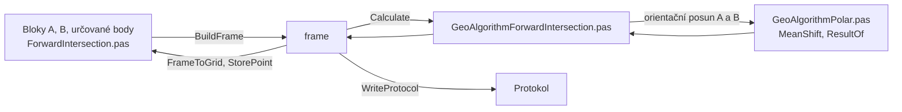

# Protínání ze směrů

Úloha 6 určí nové body ze směrů měřených na dvou orientovaných
stanoviscích. Pokrývá i protínání z úhlů.

## Co umí

- Jedna tabulka, bloky oddělené prázdným řádkem:
    1. stanovisko A a pod ním jeho orientace (číslo bodu a směr),
    2. stanovisko B a jeho orientace,
    3. určované body, u každého směr z A a směr z B.
- Souřadnice stanovisek a orientací se doplní ze seznamu.
- Protínání z úhlů: na A jediná orientace na B se směrem 0, na B
  jediná orientace na A se směrem 0. Směry k bodům jsou pak úhly od
  základny.
- Pod tabulkou se ukáže, jak program zápisník pochopil: stanoviska,
  počet orientací, orientační posun a počet určovaných bodů.
- Směr nejde zapsat u stanoviska, směr z B jen u určovaného bodu.
- Výpočet uloží určené body do seznamu, bod, který už v seznamu je,
  se přepíše s dotazem.

## Kde se co počítá

| unit | výpočet |
|---|---|
| `GUI/ForwardIntersection.pas` | tabulka → frame, výsledky zpět, protokol, uložení bodů, zápisník |
| `GeoAlgorithms/GeoAlgorithmForwardIntersection.pas` | bloky, orientace stanovisek, určované body, úhel protnutí |
| `GeoAlgorithms/GeoAlgorithmPolar.pas` | orientační posun a odchylky orientací, společné s polární metodou |

## Matematika

### Značení

| značka | v kódu | význam |
|---|---|---|
| $Y, X$ | `Y`, `X` | souřadnice S-JTSK |
| $\Delta X, \Delta Y$ | — | rozdíly ze stanoviska do bodu |
| $\psi$ | `psi`, pole `HZ`, `Zuhel` | měřený směr, z A a z B |
| $\sigma$ | `sigma`, `sigmaAP`, `sigmaBP` | směrník |
| $\varphi$ | `phi` | orientační posun stanoviska |
| $p$ | `p` | váha orientace, $s / s_{max}$ |
| $d\varphi$ | `dPhi` | odchylka orientace |
| $\sin\omega$ | `sinOmega` | sinus úhlu protnutí, 0 = rovnoběžné směry |
| $s_{AP}$ | `sAP` | délka ze stanoviska A na určovaný bod |
| $\omega$ | `omega` | úhel protnutí |

### Orientační posun

Stejně jako v polární metodě:

$$
\sigma_i = \operatorname{atan2}(\Delta Y_i, \Delta X_i)
$$

$$
\varphi = \operatorname{atan2}\left( \sum p_i \sin(\sigma_i - \psi_i),\ \sum p_i \cos(\sigma_i - \psi_i) \right), \qquad
d\varphi_i = \varphi - (\sigma_i - \psi_i)
$$

### Určovaný bod

$$
\sigma_{AP} = \psi_A + \varphi_A, \qquad \sigma_{BP} = \psi_B + \varphi_B
$$

$$
\sin\omega = \cos\sigma_{AP} \sin\sigma_{BP} - \sin\sigma_{AP} \cos\sigma_{BP}
$$

$$
s_{AP} = \frac{\Delta X_{AB} \sin\sigma_{BP} - \Delta Y_{AB} \cos\sigma_{BP}}{\sin\omega}
$$

$$
X_P = X_A + s_{AP} \cos\sigma_{AP}, \qquad Y_P = Y_A + s_{AP} \sin\sigma_{AP}
$$

$$
\omega = \left| \operatorname{atan2}\left( \sin\omega,\ \cos\sigma_{AP} \cos\sigma_{BP} + \sin\sigma_{AP} \sin\sigma_{BP} \right) \right| \cdot \frac{200}{\pi}
$$

## Přesnost

- Kód kvality určovaného bodu je horší ze stanovisek A a B.
- Odchylka orientace $d\varphi$ nad $0{,}08$ gon vypíše upozornění
  (Návod pro obnovu katastrálního operátu, bod 4.3.5.1.2 c).
- Úhel protnutí mimo 30 až 170 gon vypíše upozornění.
- Bod, který vyjde za stanoviskem A ($s_{AP} < 0$), vypíše upozornění.
- Chybějící stanovisko, orientace, souřadnice nebo směr a rovnoběžné
  směry jsou chyba.
