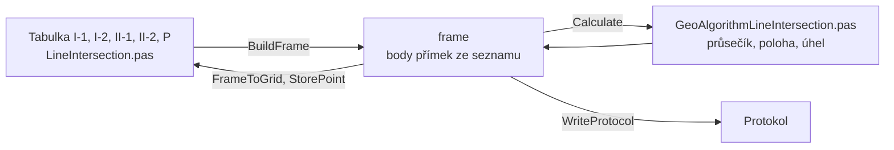

# Průsečík přímek

Úloha 3 spočítá průsečík přímky I (body I-1, I-2) s přímkou II
(body II-1, II-2).

## Co umí

- Jedna tabulka o pěti řádcích: I-1, I-2, II-1, II-2 a P. U bodů přímek
  se souřadnice a kód kvality doplní ze seznamu, do řádku P se napíše
  číslo průsečíku.
- Po každém Enteru se průsečík spočítá a pod tabulkou se ukáže, kde
  leží: na obou úsečkách, na úsečce I mimo úsečku II, na úsečce II mimo
  úsečku I, nebo na žádné.
- Výpočet uloží průsečík do seznamu, bod, který už v seznamu je, se
  přepíše s dotazem.
- Jeden zápisník je jeden průsečík.

## Kde se co počítá

| unit | výpočet |
|---|---|
| `GUI/LineIntersection.pas` | tabulka → frame, výsledek zpět, protokol, uložení bodu, zápisník |
| `GeoAlgorithms/GeoAlgorithmLineIntersection.pas` | průsečík, poloha, úhel protnutí, kód kvality |

## Matematika

### Značení

| značka | v kódu | význam |
|---|---|---|
| $Y, X$ | `Y`, `X` | souřadnice S-JTSK |
| $\Delta X_I, \Delta Y_I$ | `DeltaXI`, `DeltaYI` | rozdíly z I-1 do I-2 |
| $\Delta X_{II}, \Delta Y_{II}$ | `DeltaXII`, `DeltaYII` | rozdíly z II-1 do II-2 |
| $\Delta X_0, \Delta Y_0$ | `DeltaX0`, `DeltaY0` | rozdíly z I-1 do II-1 |
| $D$ | `D` | determinant soustavy, 0 = rovnoběžky |
| $t, u$ | `t`, `u` | poloha průsečíku na přímce I a II, 0 první bod, 1 druhý |
| $\omega$ | `omega` | úhel protnutí |

### Výpočet

$$
D = \Delta X_I\, \Delta Y_{II} - \Delta Y_I\, \Delta X_{II}
$$

$$
t = \frac{\Delta X_0\, \Delta Y_{II} - \Delta Y_0\, \Delta X_{II}}{D}, \qquad
u = \frac{\Delta X_0\, \Delta Y_I - \Delta Y_0\, \Delta X_I}{D}
$$

$$
X_P = X_{I1} + t\, \Delta X_I, \qquad Y_P = Y_{I1} + t\, \Delta Y_I
$$

$$
\omega = \left| \operatorname{atan2}\left( D,\ \Delta X_I\, \Delta X_{II} + \Delta Y_I\, \Delta Y_{II} \right) \right| \cdot \frac{200}{\pi}
$$

Průsečík leží na úsečce I, když $0 \le t \le 1$, a na úsečce II, když
$0 \le u \le 1$.

## Přesnost

- Kód kvality průsečíku je nejhorší ze čtyř bodů přímek.
- Úhel protnutí mimo 30 až 170 gon vypíše upozornění, průsečík se
  přesto spočítá.
- Rovnoběžné přímky, splývající body přímky a bod bez souřadnic jsou
  chyba.
