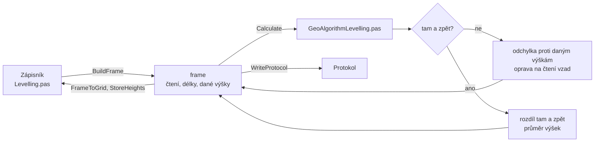

# Technická nivelace

Úloha 51 spočte výšky bodů nivelačního pořadu ze čtení na lati.
Pořad se měří jen tam, nebo tam a zpět.

## Co umí

- Jeden řádek je jedno čtení: číslo bodu, čtení vzad, vpřed nebo
  boční a délka záměry. Na řádku je vždy jen jedno čtení.
- Sestava je čtení vzad, případně boční čtení, a čtení vpřed. Pořad
  začíná čtením vzad a končí čtením vpřed.
- Řádek bez čísla bodu je přestavový bod, který se neukládá.
- Daná výška se po zadání čísla bodu doplní ze seznamu souřadnic
  a jde ji přepsat. Začátek pořadu musí mít danou výšku.
- **Jen tam:** konec se stejným číslem jako začátek je uzavřený
  pořad, konec s danou výškou je připojený pořad, konec bez dané
  výšky je pořad bez kontroly.
- **Tam a zpět** (zaškrtávátko): bod obratu se zapíše na řádek vpřed
  i na následující řádek vzad, pořad skončí na bodě začátku.
- Po každé změně se pořad přepočítá. Výpočet uloží vypočtené výšky
  do seznamu. Bod ze seznamu si ponechá polohu, nový bod má jen výšku.
- Jeden zápisník je jeden pořad.

## Kde se co počítá

| unit | výpočet |
|---|---|
| `GUI/Levelling.pas` | tabulka → frame, dané výšky ze seznamu, výsledky zpět, uložení výšek, zápisník, protokol |
| `GeoAlgorithms/GeoAlgorithmLevelling.pas` | kontrola zápisníku, převýšení, odchylka, mez, oprava, výšky |

## Matematika

### Značení

| značka | v kódu | význam |
|---|---|---|
| $z_v, z_p, z_b$ | `Xm`, `Ym`, `Zm` | čtení vzad, vpřed, boční |
| $d$ | `SH` | délka záměry |
| $h$ | `Vz` | převýšení |
| $o_i$ | `Vy` | oprava čtení vzad |
| $H$ | `VC` | vypočtená výška |
| $H_Z, H_K$ | `Z` | daná výška začátku a konce |
| $L$ | `TotalLength` | délka pořadu |
| $\delta$ | `Misclosure` | odchylka, tam a zpět rozdíl |
| $\delta_{max}$ | `Limit` | mezní odchylka |

### Převýšení a délka

$$
h = z_v - z_p, \qquad h_b = z_v - z_b
$$

$L$ je součet délek záměr vzad a vpřed všech sestav, ve vzorcích mezí
v km.

### Jen tam

$$
\delta = \sum h - (H_K - H_Z)
$$

U uzavřeného pořadu je $H_K - H_Z = 0$. Mezní odchylka:

$$
\delta_{max} = 20\ \mathrm{mm} \cdot \sqrt{L / 2}
$$

Oprava $-\delta$ se rozdělí po celých mm rovnoměrně na čtení vzad.
Zbylé milimetry dostanou postupně největší čtení vzad, u stejných
čtení dřívější.

Výšky se počítají přes horizont přístroje:

$$
H_h = H + z_v + o_i, \qquad H_{vpřed} = H_h - z_p, \qquad H_{boční} = H_h - z_b
$$

### Tam a zpět

$$
\delta = \sum h_{tam} + \sum h_{zpět}, \qquad L = \frac{L_{tam} + L_{zpět}}{2}
$$

$$
\delta_{max} = 20\ \mathrm{mm} \cdot \sqrt{L}
$$

Každá cesta se počítá zvlášť, cesta zpět navazuje na výšku bodu
obratu a její výšky se posunou o $-\delta$. Bod měřený tam i zpět
dostane průměr obou výšek. Začátek si ponechá danou výšku. Čtení se
neopravují.

## Přesnost

- Mez je podle vyhlášky 31/1995 Sb., příloha bod 4.9: tam a zpět
  $20\ \mathrm{mm} \cdot \sqrt{L}$, jen tam proti daným výškám
  $20\ \mathrm{mm} \cdot \sqrt{L/2}$. Odchylka nad mezí vypíše
  upozornění.
- Pořad bez dané výšky konce vypíše upozornění, že výšky jsou
  bez kontroly.
- Chyba: řádek bez čtení nebo s více čteními, čtení ve špatném
  pořadí, chybí délka záměry, začátek bez dané výšky, nulový součet
  délek. Tam a zpět navíc: pořad nekončí na začátku, bod obratu chybí
  nebo je víckrát.
