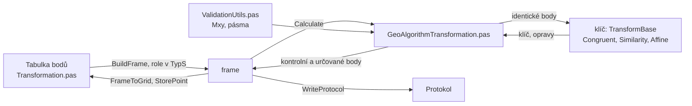

# Transformace

Úloha 65 převede body ze zdrojové soustavy do cílové podle identických
bodů. S nadbytkem bodů se klíč vyrovná metodou nejmenších čtverců (MNČ).
Transformace je rovinná, výšky se netransformují.

## Co umí

| typ | parametry | min. bodů |
|---|---|---|
| shodnostní | posun, otočení (3) | 2 |
| podobnostní (Helmertova) | + měřítko (4) | 2 |
| afinní | 6 | 3 |

- Shodnostní má nadbytek vždy, ostatní s minimem bodů vyjdou přesně.
- Transformace jde oběma směry: kladná čísla bodů z místní soustavy do
  S-JTSK, záporná zpět. Body jedné úlohy mají stejné znaménko, jinak
  výpočet ohlásí chybu.
- Bod, který je v klíči dvakrát (stejné číslo cíle nebo zdroje), se
  počítá s dvojnásobnou vahou a protokol na to upozorní.
- Role bodu podle seznamu souřadnic a zaškrtnutí ve sloupci Klíč:
  **identický** (je v seznamu, zaškrtnutý, jde do klíče), **kontrolní**
  (je v seznamu, nezaškrtnutý, jen odchylky), **určovaný** (není
  v seznamu, dopočte se a uloží).
- Na začátku je zaškrtnuté vše. Zaškrtnutí v hlavičce přepne všechny
  řádky, mezerník přepne řádek pod kurzorem.
- Určovaný bod dostane jen Y a X. Nový bod se uloží s výškou 0, bod,
  který už v seznamu je, si svou výšku ponechá.

## Kde se co počítá

| unit | výpočet |
|---|---|
| `GUI/Transformation.pas` | tabulka → frame (role v `TypS`: 1, 2, 3), výsledky zpět, uložení bodů, zápisník, protokol |
| `GeoAlgorithms/GeoAlgorithmTransformation.pas` | řízení výpočtu, kontrolní a určované body, počty bodů v pásmech |
| `GeoAlgorithms/GeoAlgorithmTransformBase.pas` | předek klíčů: těžiště, posuny, transformace bodů, opravy |
| `GeoAlgorithms/GeoAlgorithmTransformSimilarity.pas` | podobnostní, λ1 a λ2 |
| `GeoAlgorithms/GeoAlgorithmTransformCongruent.pas` | shodnostní, potomek podobnostní |
| `GeoAlgorithms/GeoAlgorithmTransformAffine.pas` | afinní |
| `Utils/ValidationUtils.pas` | Mxy kódu kvality a pásma |

## Matematika

### Značení

- Soustava II (místní, zdrojová): $x, y$. Soustava I (cílová, S-JTSK):
  $X, Y$.
- $n$ identických bodů, $T$ jejich těžiště, index $r$ souřadnice
  redukované k těžišti.
- $[\ ]$ Gaussův součet redukovaných souřadnic přes identické body,
  např. $[xX] = \sum x_r X_r$, $[xx] = \sum x_r^2$.
- Opravy $v$ = transformovaná − daná.

### Redukce k těžišti

Společná všem transformacím:

$$
x_T = \frac{\sum x}{n}, \quad y_T = \frac{\sum y}{n}, \quad X_T = \frac{\sum X}{n}, \quad Y_T = \frac{\sum Y}{n}
$$

$$
x_r = x - x_T, \quad y_r = y - y_T, \quad X_r = X - X_T, \quad Y_r = Y - Y_T
$$

Klíč se určí z podmínky MNČ $[v_X v_X + v_Y v_Y] = \min$. Podmínky pro
posuny $X_0, Y_0$ vedou vždy k tomu, že se těžiště soustavy II zobrazí
na těžiště soustavy I, posuny se proto počítají až nakonec z těžišť.
Redukce navíc drží přesnost, souřadnice v milionech metrů by v součtech
ztratily platné číslice.

### Podobnostní (Helmertova)

Transformační rovnice:

$$
X = X_0 + \lambda_1 x - \lambda_2 y, \qquad Y = Y_0 + \lambda_1 y + \lambda_2 x
$$

Rovnice oprav identického bodu:

$$
v_X = \lambda_1 x_r - \lambda_2 y_r - X_r, \qquad v_Y = \lambda_1 y_r + \lambda_2 x_r - Y_r
$$

Z podmínek $\partial[vv]/\partial\lambda_1 = 0$ a
$\partial[vv]/\partial\lambda_2 = 0$ vzniknou normální rovnice. Smíšený
součet $[xy]$ se v nich vyruší a soustava je diagonální:

$$
\lambda_1 ([xx] + [yy]) = [xX] + [yY], \qquad \lambda_2 ([xx] + [yy]) = [xY] - [yX]
$$

Transformační klíč:

$$
\lambda_1 = \frac{\sum (x_r X_r + y_r Y_r)}{\sum (x_r^2 + y_r^2)}, \qquad
\lambda_2 = \frac{\sum (x_r Y_r - y_r X_r)}{\sum (x_r^2 + y_r^2)}
$$

$$
X_0 = X_T - \lambda_1 x_T + \lambda_2 y_T, \qquad Y_0 = Y_T - \lambda_1 y_T - \lambda_2 x_T
$$

$$
q = \sqrt{\lambda_1^2 + \lambda_2^2}, \qquad \tan\omega = \frac{\lambda_2}{\lambda_1}
$$

Kvadrant úhlu $\omega$ se určí podle znamének $\lambda_1$, $\lambda_2$.

- 4 parametry, minimum 2 body.
- $[xx] + [yy] = 0$ znamená, že identické body splývají.

### Shodnostní

Měřítko $q = 1$, transformační rovnice:

$$
X = X_0 + x \cos\omega - y \sin\omega, \qquad Y = Y_0 + y \cos\omega + x \sin\omega
$$

Otočení nemění délky,

$$
(x_r \cos\omega - y_r \sin\omega)^2 + (y_r \cos\omega + x_r \sin\omega)^2 = x_r^2 + y_r^2 ,
$$

a proto podmínka MNČ přejde na

$$
[vv] = \text{konst} - 2 \left[ \cos\omega ([xX] + [yY]) + \sin\omega ([xY] - [yX]) \right] = \min
$$

Minimum nastane pro stejný úhel $\omega$ jako u podobnostní
transformace. Transformační klíč:

$$
\cos\omega = \frac{\lambda_1}{q}, \qquad \sin\omega = \frac{\lambda_2}{q}
$$

$$
X_0 = X_T - x_T \cos\omega + y_T \sin\omega, \qquad Y_0 = Y_T - y_T \cos\omega - x_T \sin\omega
$$

- 3 parametry, minimum 2 body.
- Program spočte klíč podobnostní transformace a $\lambda_1$, $\lambda_2$
  vydělí měřítkem $q$.

### Afinní

Transformační rovnice:

$$
X = X_0 + a_1 x + a_2 y, \qquad Y = Y_0 + b_1 x + b_2 y
$$

Rovnice oprav identického bodu:

$$
v_X = a_1 x_r + a_2 y_r - X_r, \qquad v_Y = b_1 x_r + b_2 y_r - Y_r
$$

Koeficienty $a_1, a_2$ jsou jen ve $v_X$, koeficienty $b_1, b_2$ jen
ve $v_Y$, úloha se rozpadne na dvě nezávislé. Normální rovnice mají obě
stejnou matici:

$$
\begin{aligned}
a_1 [xx] + a_2 [xy] &= [xX] & \qquad b_1 [xx] + b_2 [xy] &= [xY] \\
a_1 [xy] + a_2 [yy] &= [yX] & \qquad b_1 [xy] + b_2 [yy] &= [yY]
\end{aligned}
$$

Determinant a řešení (Cramerovo pravidlo):

$$
D = [xx][yy] - [xy]^2
$$

$$
a_1 = \frac{[xX][yy] - [yX][xy]}{D}, \qquad b_1 = \frac{[xY][yy] - [yY][xy]}{D}
$$

$$
a_2 = \frac{[yX][xx] - [xX][xy]}{D}, \qquad b_2 = \frac{[yY][xx] - [xY][xy]}{D}
$$

$$
X_0 = X_T - a_1 x_T - a_2 y_T, \qquad Y_0 = Y_T - b_1 x_T - b_2 y_T
$$

- Vždy $D \ge 0$ (Cauchyova-Schwarzova nerovnost), $D = 0$ právě když
  identické body leží v přímce.
- 6 parametrů, minimum 3 body.
- Program počítá přímo tyto vzorce.

### Klíč v protokolu

Protokol píše klíč nejdřív pro Y:

$$
Y = Y_0 + A_{11} y + A_{12} x, \qquad X = X_0 + A_{21} y + A_{22} x
$$

| | $A_{11}$ | $A_{12}$ | $A_{21}$ | $A_{22}$ |
|---|---|---|---|---|
| podobnostní | $\lambda_1$ | $\lambda_2$ | $-\lambda_2$ | $\lambda_1$ |
| shodnostní | $\cos\omega$ | $\sin\omega$ | $-\sin\omega$ | $\cos\omega$ |
| afinní | $b_2$ | $b_1$ | $a_2$ | $a_1$ |

## Přesnost

$$
S_{xy} = \sqrt{\frac{v_X^2 + v_Y^2}{2}}, \qquad m = \sqrt{\frac{[v_X v_X + v_Y v_Y]}{n'}}
$$

$n' = 2n - 3$ u shodnostní, $2n - 4$ u podobnostní (počet nadbytečných
měření).

- Kontrola: $[v_X] = [v_Y] = 0$.
- $m$ se jen vypisuje, u afinní ne, a jen když je $n'$ větší než nula.
- Bod se posoudí podle $S_{xy}$ proti $M_{xy}$ svého kódu kvality
  (KatV 13.9, 15.6): do Mxy (menší než $M_{xy}$), do Uxy (nepřekročí
  $U_{xy}$), přes Uxy, $U_{xy} = 2\,M_{xy}$.
- Protokol vyhodnotí kritéria KatV 13.8: všechny body do Uxy a při více
  než 20 bodech nejméně 40 % do Mxy. Jen když mají všechny body Mxy.
- Rozmístění identických bodů (KatV § 75 odst. 4): kružnice se středem
  v polovině spojnice dvou nejvzdálenějších identických bodů, poloměr
  ¾ její délky. Zaměřené body (určované i kontrolní) mimo kružnici
  protokol vypíše.
