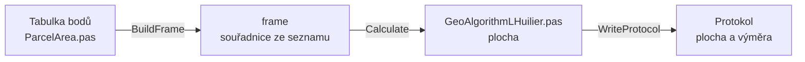

# Výpočet výměr

Úloha 95 spočte plochu parcely ze souřadnic lomových bodů
a zaokrouhlí ji na výměru.

## Co umí

- Jeden řádek je jeden lomový bod. Souřadnice se vezmou ze seznamu
  souřadnic, tabulka je jen ukazuje.
- Řádky bez čísla bodu se přeskočí. Č. v protokolu odpovídá řádku
  v tabulce.
- Pořadí bodů může být po směru i proti směru hodinových ručiček.
- Do pole Parcela jde napsat označení parcely, protokol ho uvede.
- Nic se neukládá do seznamu souřadnic.
- Jeden zápisník je jedna parcela.

## Kde se co počítá

| unit | výpočet |
|---|---|
| `GUI/ParcelArea.pas` | tabulka → frame, body ze seznamu, výměra, zápisník, protokol |
| `GeoAlgorithms/GeoAlgorithmLHuilier.pas` | plocha |

## Matematika

### Značení

| značka | v kódu | význam |
|---|---|---|
| $Y_i, X_i$ | `Rows[i].Y`, `Rows[i].X` | souřadnice i-tého bodu |
| $n$ | `n` | počet bodů |
| $P$ | `Area` | plocha |
| $V$ | | výměra |

### Výpočet

L'Huilierův vzorec, bod $n$ je zase bod $0$:

$$
P = \frac{1}{2} \left| \sum_{i=0}^{n-1} \left( Y_i X_{i+1} - Y_{i+1} X_i \right) \right|
$$

Výměra je plocha zaokrouhlená na celé m², nejméně 1 m²
(KatV § 82 odst. 2):

$$
V = \max\left(1,\ \lfloor P + 0{,}5 \rfloor\right)
$$

## Přesnost

- Plocha se v protokolu vypíše na počet desetinných míst z Nastavení,
  výměra na celé m².
- Chyba: méně než 3 body, bod není v seznamu souřadnic, nulová plocha
  (body na jedné přímce). Po chybě se výměra nevypíše.
