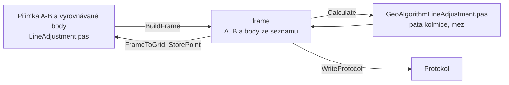

# Vyrovnání do přímky

Úloha 2 posune bod na řídící přímku A-B. Z bodu se spustí kolmice
a vyrovnaný bod leží v její patě.

## Co umí

- Horní tabulka je řídící přímka: body A a B, souřadnice a kód kvality
  se doplní ze seznamu.
- Dolní tabulka jsou vyrovnávané body: bod, ze kterého se spouští
  kolmice, a nové číslo. Prázdné nové číslo přesune původní bod,
  vyplněné vytvoří nový bod a původní zůstane.
- Po každém Enteru se ukáže pata kolmice a délka kolmice. Kolmice
  vpravo od směru A→B je kladná, jako v ortogonální metodě.
- Výpočet uloží vyrovnané body do seznamu, bod, který už v seznamu je,
  se přepíše s dotazem. Vyrovnaný bod si ponechá výšku a popis
  původního bodu.
- Opakovaný výpočet počítá vždy z bodu před posunem.
- Jeden zápisník je jedna přímka.

## Kde se co počítá

| unit | výpočet |
|---|---|
| `GUI/LineAdjustment.pas` | tabulky → frame, výsledky zpět, protokol, uložení bodů, zápisník |
| `GeoAlgorithms/GeoAlgorithmLineAdjustment.pas` | pata kolmice, délka kolmice, kód kvality, mez |

## Matematika

### Značení

| značka | v kódu | význam |
|---|---|---|
| $Y, X$ | `Y`, `X` | souřadnice S-JTSK |
| $\Delta X_{AB}, \Delta Y_{AB}$ | `DeltaXAB`, `DeltaYAB` | rozdíly z A do B |
| $s_{AB}$ | `sAB` | délka přímky |
| $k$ | `k` | kolmice bodu P, vpravo od A→B kladná |

### Výpočet

$$
s_{AB} = \sqrt{\Delta X_{AB}^2 + \Delta Y_{AB}^2}
$$

$$
k = \frac{(Y_P - Y_A)\, \Delta X_{AB} - (X_P - X_A)\, \Delta Y_{AB}}{s_{AB}}
$$

$$
X_P' = X_P + \frac{k\, \Delta Y_{AB}}{s_{AB}}, \qquad Y_P' = Y_P - \frac{k\, \Delta X_{AB}}{s_{AB}}
$$

## Přesnost

- Kód kvality vyrovnaného bodu je horší z bodů A a B.
- Mez délky kolmice je $U_{xy} = 2\,M_{xy}$ toho kódu. Delší kolmice
  vypíše upozornění, bod se přesto vyrovná. Pro kódy bez Mxy se
  mez nekontroluje.
- Body A a B blíž než 1 mm a bod bez souřadnic jsou chyba.
